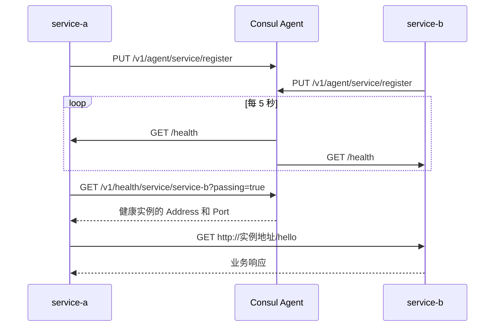

# Consul 特性与本项目实践指南

本文介绍 Consul 的核心能力，并结合本项目的 `service-a` 和 `service-b`，说明以下常用场景：

- 服务启动时注册到 Consul，停止时主动注销；
- Consul 定时请求服务的健康检查接口；
- 服务通过 Consul 查找健康的内部服务实例；
- 服务从多个健康实例中选择一个并发起 HTTP 调用；
- 服务异常、Consul 异常以及网络地址配置错误时如何定位问题。

## 1. Consul 是什么

Consul 是一个服务网络平台。本项目主要使用它的“服务注册、健康检查、服务发现”能力，把 Consul 当作内部服务目录：服务提供者将自己的名称、地址和端口注册进去，服务消费者按服务名查询健康实例，而不需要把对端的固定 IP 和端口写死在业务代码中。

除本项目已经使用的能力外，Consul 还提供：

| 能力 | 作用 | 本项目是否使用 |
| --- | --- | --- |
| 服务目录（Catalog） | 保存服务名称、实例、节点、标签和元数据 | 是 |
| 健康检查 | 通过 HTTP、TCP、gRPC、TTL 等方式判断实例是否可用 | 是，使用 HTTP 检查 |
| 服务发现 | 通过 HTTP API 或 DNS 查询服务实例 | 是，使用 HTTP API |
| KV 存储 | 保存少量动态配置或协调数据 | 否 |
| ACL | 限制服务注册、查询和管理权限 | 代码已支持令牌，开发环境可不启用 |
| 多数据中心和高可用 | 在多个 Consul Server 之间复制并维护目录状态 | 当前本地示例未体现 |
| Consul Service Mesh | 通过代理、mTLS 和 intentions 管理服务间通信 | 否；当前服务直接通过 HTTP 通信 |

> Consul 在当前模式下只负责返回可用实例的地址，并不转发 `service-a` 到 `service-b` 的业务请求。真正发起 HTTP 请求、选择实例和失败切换的仍是调用方代码。

## 2. 先理解几个关键概念

### 2.1 Service Name 和 Service ID

- **Service Name** 是逻辑服务名，例如 `service-b`。同一种服务的多个实例应使用同一个 Service Name，调用方也按它进行发现。
- **Service ID** 标识一个具体实例，例如 `service-b-local`、`service-b-node-2`。同一个 Consul Agent 上的 Service ID 必须唯一。

例如，部署三个 `service-b` 实例时，可以使用：

| Service Name | Service ID | 地址 |
| --- | --- | --- |
| `service-b` | `service-b-1` | `10.0.0.11:8002` |
| `service-b` | `service-b-2` | `10.0.0.12:8002` |
| `service-b` | `service-b-3` | `10.0.0.13:8002` |

调用方只查询 `service-b`，Consul 返回当前健康的实例列表。

### 2.2 Consul Agent、Server 和 Catalog

- Consul Agent 是每个节点上运行的 Consul 进程，可以接收服务注册、执行本地健康检查并响应 HTTP/DNS 查询。
- Consul Server 负责保存集群状态并通过 Raft 达成一致。生产集群通常部署多个 Server，以避免单点故障。
- Catalog 是集群中的服务目录。服务向 Agent 注册后，由 Agent 将状态同步到 Catalog。

本项目通过 `http://127.0.0.1:8500` 调用 Consul HTTP API。本地只有一个 Consul 容器时，这个进程可能同时承担 Agent 和 Server 的角色；生产环境中，应用通常访问本机或同节点的 Client Agent。

### 2.3 健康状态

Consul 健康检查主要有三种状态：

- `passing`：健康，可以参与服务发现和调用；
- `warning`：警告，需要关注；
- `critical`：不健康，不应继续接收正常业务流量。

本项目发现服务时使用 `passing=true`，因此只接收所有相关检查均为 `passing` 的实例。

## 3. 本项目的调用拓扑

本项目包含两个独立的 FastAPI 应用：

| 项目 | Service Name | Service ID | 业务地址 | 调用目标 |
| --- | --- | --- | --- | --- |
| `service-a` | `service-a` | `service-a-local` | `127.0.0.1:8001` | `service-b` |
| `service-b` | `service-b` | `service-b-local` | `127.0.0.1:8002` | `service-a` |

完整链路如下：



相关实现位置：

- 服务注册、注销和发现：`service-a/src/service_a/consul.py`、`service-b/src/service_b/consul.py`；
- 应用生命周期、健康接口和内部调用：`service-a/src/service_a/app.py`、`service-b/src/service_b/app.py`；
- 显式启动入口：`service-a/main.py`、`service-b/main.py`；
- 监听地址、发布地址、端口和健康检查 URL：两个包中的 `config.py`；
- 配置模型：`service-a/src/service_a/settings.py`、`service-b/src/service_b/settings.py`；
- 本地配置模板：`service-a/.env.example`、`service-b/.env.example`。

## 4. 场景一：服务注册到 Consul

### 4.1 注册时机

两个服务都使用 FastAPI 的 `lifespan`：

1. 应用启动时创建 `ConsulClient`；
2. 调用 `register()` 注册当前实例及其健康检查；
3. 注册成功后才开始对外提供服务；
4. 应用正常关闭时调用 `deregister()` 注销实例；
5. 最后关闭访问 Consul 和内部服务所使用的 HTTP 客户端。

因此，按当前实现，如果启动阶段无法连接 Consul，注册会抛出 `ConsulError`，FastAPI 启动也会失败。这是一种“没有注册中心就不提供服务”的 fail-fast 策略。

### 4.2 当前项目发送的注册数据

以 `service-a` 为例，代码等价于向 Consul 发送以下请求：

```bash
curl --request PUT \
  --header 'Content-Type: application/json' \
  --data '{
    "ID": "service-a-local",
    "Name": "service-a",
    "Address": "127.0.0.1",
    "Port": 8001,
    "Tags": ["fastapi", "python-3.13"],
    "Meta": {"peer_service": "service-b"},
    "Check": {
      "CheckID": "service:service-a-local",
      "Name": "service-a HTTP 健康检查",
      "HTTP": "http://host.docker.internal:8001/health",
      "Method": "GET",
      "Interval": "5s",
      "Timeout": "2s",
      "DeregisterCriticalServiceAfter": "60s"
    }
  }' \
  http://127.0.0.1:8500/v1/agent/service/register
```

主要字段含义：

| 字段 | 含义 |
| --- | --- |
| `ID` | 当前实例的唯一标识 |
| `Name` | 供其他服务查询的逻辑服务名 |
| `Address`、`Port` | Consul 返回给调用方的业务访问地址 |
| `Tags` | 可用于版本、协议、环境等分类和过滤 |
| `Meta` | 附加元数据，不直接影响路由 |
| `Check` | 与服务一起注册的健康检查定义 |

注册接口是幂等式更新：使用同一个 Service ID 再次注册会更新该实例，而不是创建一个新实例。因此，多实例部署时不能共用同一个 Service ID。

### 4.3 正常注销与异常退出

正常关闭时，项目会调用：

```text
PUT /v1/agent/service/deregister/{service_id}
```

正常注销能及时从目录中移除实例。如果进程崩溃、主机断电或被强制终止，清理逻辑没有机会执行，Consul 会在健康检查失败后把实例标记为 `critical`。本项目还设置了 `DeregisterCriticalServiceAfter=60s`，让 Consul 在实例持续处于 `critical` 状态一段时间后自动注销它。

自动注销是兜底手段，不应代替优雅停机。部署平台停止实例时，应先停止接收新流量，再执行应用关闭流程。

## 5. 场景二：Consul 定时检查服务健康状态

### 5.1 当前检查策略

本项目注册的是主动 HTTP 检查：

- Consul 每 5 秒请求一次服务的 `/health`；
- 单次请求 2 秒未完成则超时；
- HTTP `200`～`299` 表示 `passing`；
- HTTP `429` 表示 `warning`；
- 其他状态码、连接失败或超时表示检查失败，通常进入 `critical`；
- 持续 `critical` 达到自动注销时间后，Consul 删除该实例及其检查。

`service-a` 的健康接口响应示例：

```json
{
  "status": "正常",
  "service": "service-a",
  "service_id": "service-a-local"
}
```

Consul 主要根据 HTTP 状态码判断结果，并不理解 JSON 中 `status` 字段的业务含义。

### 5.2 为什么健康检查地址和服务地址不同

当前开发环境有两个不同的访问方向：

| 代码常量 | 当前值 | 谁使用 | 用途 |
| --- | --- | --- | --- |
| `SERVICE_ADVERTISE_HOST` | `127.0.0.1` | `service-a` / `service-b` | 调用已发现的内部服务 |
| `CONSUL_HEALTH_CHECK_URL` | `http://host.docker.internal:<端口>/health` | Consul 容器 | 从容器访问宿主机上的 FastAPI 服务 |

Consul 运行在容器中时，容器内的 `127.0.0.1` 指向容器自身，而不是宿主机，所以检查宿主机服务需要 `host.docker.internal`。同时，两个 FastAPI 进程都在宿主机上，发现结果使用 `127.0.0.1` 又是可达的。

如果以后把两个服务也放进不同容器，不能继续发布 `127.0.0.1`，应改为调用方可访问的容器 DNS 名称或容器网络 IP。判断原则是：

- 健康检查 URL 必须能从执行检查的 Consul Agent 访问；
- 注册的 `Address:Port` 必须能从服务调用方访问。

### 5.3 `/health` 应该检查什么

当前 `/health` 只证明 FastAPI 进程能够响应，属于轻量的存活/就绪检查。实践中应注意：

- 接口必须快速、稳定，耗时应显著小于 Consul 的 `Timeout`；
- 不要在健康接口中执行高成本查询；
- 如果服务缺少数据库等关键依赖就完全无法工作，可以将必要依赖纳入就绪判断；
- 不要无条件检查所有下游微服务，否则一个下游故障可能造成大面积级联摘除；
- 不要返回敏感信息和详细异常堆栈。

### 5.4 查看检查结果

```bash
# 查看 service-a 的检查
curl http://127.0.0.1:8500/v1/health/checks/service-a

# 只查看 service-a 的健康实例
curl 'http://127.0.0.1:8500/v1/health/service/service-a?passing=true'

# 查看全部 critical 检查
curl http://127.0.0.1:8500/v1/health/state/critical
```

也可以打开 Consul UI：

```text
http://127.0.0.1:8500/ui/
```

## 6. 场景三：发现并调用内部服务

### 6.1 查询健康实例

当访问 `service-a` 的 `/call-peer` 时，`service-a` 查询：

```http
GET /v1/health/service/service-b?passing=true
```

其中：

- 路径中的 `service-b` 是 Service Name，而不是某个 Service ID；
- `passing=true` 让 Consul 只返回健康实例；
- 每条结果都包含 `Node`、`Service` 和 `Checks`；
- 当前代码优先读取 `Service.Address`，为空时回退到 `Node.Address`，并读取 `Service.Port`。

手动查询：

```bash
curl 'http://127.0.0.1:8500/v1/health/service/service-b?passing=true'
```

### 6.2 选择实例并发起调用

当前 `/call-peer` 的处理过程是：

1. 从 Consul 获取目标服务的所有健康实例；
2. 随机打乱实例列表，实现简单的客户端负载均衡；
3. 依次请求每个实例的 `/hello`；
4. 某个实例调用成功就立即返回；
5. 某个实例连接失败、返回非成功状态或响应不是合法 JSON，就继续尝试下一个实例。

这是一种客户端服务发现模式：调用方负责发现、负载均衡和故障切换。

### 6.3 当前错误语义

| 情况 | `/call-peer` 返回 |
| --- | --- |
| 查询 Consul 失败 | HTTP `503` |
| Consul 中没有健康实例 | HTTP `503` |
| 找到了实例，但所有实例的业务调用均失败 | HTTP `502` |
| 至少一个实例调用成功 | HTTP `200` |

验证双向调用：

```bash
# service-a 发现并调用 service-b
curl http://127.0.0.1:8001/call-peer

# service-b 发现并调用 service-a
curl http://127.0.0.1:8002/call-peer
```

成功响应示例：

```json
{
  "caller": "service-a",
  "discovered_service": "service-b",
  "target": "http://127.0.0.1:8002",
  "response": {
    "message": "你好，这里是服务 B",
    "service": "service-b",
    "service_id": "service-b-local"
  }
}
```

### 6.4 健康不等于本次调用一定成功

健康检查和业务调用之间存在时间窗口：Consul 返回实例后，实例仍可能立即退出或网络可能中断。因此调用方仍需要设置超时、处理连接错误，并在幂等请求上谨慎重试。

当前代码已设置 HTTP 超时并尝试其他已发现实例。生产环境还应结合业务语义考虑：

- 仅自动重试幂等操作，或使用幂等键防止重复写入；
- 限制重试次数并添加退避，避免故障时放大流量；
- 根据实例数和调用量选择轮询、随机或加权策略；
- 对 Consul 查询失败和业务调用失败分别监控；
- 高请求量场景可考虑缓存、Consul blocking query、DNS 或专用代理，避免每个业务请求都同步查询 Consul。

## 7. 项目配置说明

两个服务通过 `.env` 使用相同的环境变量，但默认值不同：

| 环境变量 | 作用 | `service-a` 默认值 | `service-b` 默认值 |
| --- | --- | --- | --- |
| `CONSUL_HTTP_ADDR` | Consul HTTP API 地址 | `http://127.0.0.1:8500` | 同左 |
| `CONSUL_TOKEN` | ACL 令牌；未启用 ACL 时可留空 | 空 | 空 |
| `SERVICE_NAME` | 逻辑服务名 | `service-a` | `service-b` |
| `SERVICE_ID` | 当前实例 ID | `service-a-local` | `service-b-local` |
| `PEER_SERVICE_NAME` | `/call-peer` 要发现的服务名 | `service-b` | `service-a` |
| `CONSUL_HEALTH_INTERVAL_SECONDS` | 检查间隔 | `5` | `5` |
| `CONSUL_HEALTH_TIMEOUT_SECONDS` | 单次检查超时 | `2` | `2` |
| `CONSUL_DEREGISTER_AFTER_SECONDS` | 持续 critical 后自动注销的时间 | `60` | `60` |
| `HTTP_TIMEOUT_SECONDS` | 访问 Consul 和内部服务的 HTTP 超时 | `5` | `5` |

监听地址、注册地址、端口和健康检查 URL 固定定义在各服务的 `config.py` 中：

| 代码常量 | `service-a` | `service-b` |
| --- | --- | --- |
| `SERVICE_BIND_HOST` | `0.0.0.0` | `0.0.0.0` |
| `SERVICE_ADVERTISE_HOST` | `127.0.0.1` | `127.0.0.1` |
| `SERVICE_PORT` | `8001` | `8002` |
| `CONSUL_HEALTH_CHECK_URL` | `http://host.docker.internal:8001/health` | `http://host.docker.internal:8002/health` |

这些常量不是环境变量，修改 `.env` 不会覆盖它们。改变部署网络或端口时，需要同步修改对应服务的 `config.py`，并确保 Uvicorn 监听端口与注册到 Consul 的端口一致。

`Settings` 会校验 Consul 地址使用 HTTP(S)、各时间值为正数，并要求健康检查超时小于检查间隔。

## 8. 本地运行和完整验证

项目使用 `uv` 管理两个独立的 Python 环境。

### 8.1 确认 Consul 可访问

```bash
curl http://127.0.0.1:8500/v1/status/leader
```

如果 Consul 在 Docker 中，确保容器配置了宿主机网关映射，使 `host.docker.internal` 可解析并能访问宿主机端口。

### 8.2 启动两个服务

终端一：

```bash
cd service-a
uv sync
uv run main
```

终端二：

```bash
cd service-b
uv sync
uv run main
```

### 8.3 验证注册、检查和调用

```bash
# 查看本地 Agent 上注册的服务
curl http://127.0.0.1:8500/v1/agent/services

# 查看健康实例
curl 'http://127.0.0.1:8500/v1/health/service/service-a?passing=true'
curl 'http://127.0.0.1:8500/v1/health/service/service-b?passing=true'

# 执行内部服务调用
curl http://127.0.0.1:8001/call-peer
curl http://127.0.0.1:8002/call-peer
```

### 8.4 验证故障摘除

1. 保持两个服务都在运行，确认 `/call-peer` 成功；
2. 强制停止 `service-b`，让它没有机会正常注销，或暂时让 `/health` 不可访问；
3. 在 Consul UI 或 `/v1/health/checks/service-b` 中观察检查变为 `critical`；
4. 查询 `passing=true`，确认故障实例不再返回；
5. 访问 `service-a` 的 `/call-peer`，确认返回 `503`；
6. 重新启动 `service-b`，健康检查恢复后再次调用。

如果使用 `Ctrl+C` 正常停止，服务会主动注销，可能看不到从 `critical` 到自动清理的过程。

## 9. 多实例扩容示例

横向扩容的关键规则是：Service Name 相同，Service ID 唯一；同一主机上的各实例还需要使用不同的监听端口和健康检查 URL。当前示例按本地学习需求将监听地址和端口固定在代码中，因此新增实例前需要准备独立的部署副本并调整该副本的 `config.py`。

例如，在宿主机上额外启动一个 `service-b` 实例：

```bash
cd service-b
# 在独立部署副本中，将 src/service_b/config.py 的 SERVICE_PORT 改为 8003；
# CONSUL_HEALTH_CHECK_URL 会随端口生成，再将该副本 .env 中的 SERVICE_ID 改为唯一值。
uv run main
```

如果需要频繁使用同一份构建产物进行扩缩容，可以后续将端口、发布地址和健康检查地址改为由部署环境注入；当前代码结构更适合固定端口的本地学习环境。

随后查询：

```bash
curl 'http://127.0.0.1:8500/v1/health/service/service-b?passing=true'
```

应该能看到两个 `service-b` 实例。多次请求 `service-a/call-peer` 时，当前代码会随机选择实例；如果首选实例调用失败，则尝试列表中的下一个实例。

## 10. 常见问题排查

### 10.1 服务启动失败，日志显示无法连接 Consul

- 用 `/v1/status/leader` 确认 Consul HTTP API 可访问；
- 检查 `CONSUL_HTTP_ADDR` 的协议、主机和端口；
- 如果启用了 ACL，检查 `CONSUL_TOKEN` 是否有效且具备权限；
- 如果使用 HTTPS，当前地址需改为 `https://...`，并正确配置证书信任。

### 10.2 服务已注册，但健康状态是 critical

- 从 Consul 所在的容器或主机直接请求 `config.py` 中的 `CONSUL_HEALTH_CHECK_URL`；
- 确认 FastAPI 监听 `0.0.0.0`，而不只是监听宿主机的 `127.0.0.1`；
- 检查 `host.docker.internal` 映射、防火墙、端口和 `/health` 路径；
- 查看健康检查的 `Output` 字段，它通常包含连接失败或超时原因。

### 10.3 Consul 返回健康实例，但调用失败

- 检查 `config.py` 中注册的 `SERVICE_ADVERTISE_HOST:SERVICE_PORT` 是否能从调用方访问；
- 注意容器、宿主机和远程主机中的 `127.0.0.1` 含义不同；
- 直接从调用方所在网络环境请求实例的 `/hello`；
- 检查健康检查地址和发布地址是否被误认为必须相同。

### 10.4 查询不到服务

- 确认查询的是 Service Name，不是 Service ID；
- 去掉 `passing=true` 查询一次，判断是未注册还是健康检查未通过；
- 检查服务是否已因持续 `critical` 被自动注销；
- 开启 ACL 时，确认令牌有 `service:read` 和 `node:read` 权限；
- 多数据中心场景检查查询的 datacenter 是否正确。

### 10.5 出现重复或陈旧实例

- 每个实例必须使用唯一 Service ID；
- 确认应用是否完成正常注销；
- 为异常退出保留 `DeregisterCriticalServiceAfter`；
- 必要时调用注销接口清理确定不再存在的实例：

```bash
curl --request PUT \
  http://127.0.0.1:8500/v1/agent/service/deregister/service-b-local
```

## 11. 生产环境建议

### 11.1 启用 ACL 并使用最小权限令牌

本项目会在配置了 `CONSUL_TOKEN` 时自动添加 `X-Consul-Token` 请求头。不要给应用分发 Consul 管理令牌，应创建只允许它注册自身和读取目标服务的策略。当前调用至少涉及：

- 注册和注销自身服务：`service:write`；
- 通过 Health API 发现服务：`service:read` 和 `node:read`。

令牌属于秘密，不应提交到 Git。应通过部署平台的 Secret、环境变量注入或专门的秘密管理系统提供。

### 11.2 加密并限制 Consul 接口

生产环境不应直接照搬本地开发配置。应根据部署方式配置 ACL、Agent 间 TLS、gossip 加密、网络访问控制和审计。Consul 官方文档明确说明其默认配置并不等同于安全的生产配置。

### 11.3 避免单点 Consul Server

本地单节点适合学习和开发。生产环境应使用奇数个 Consul Server 形成高可用集群，规划备份、监控和故障恢复，并让应用就近访问 Consul Agent。

### 11.4 设计清晰的就绪和停机流程

- 服务启动完成且关键依赖可用后才进入 `passing`；
- 发布或维护前可以使用 Consul maintenance mode 先将实例从发现结果中摘除；
- 等待在途请求完成后再关闭进程并注销；
- 健康检查间隔、阈值和自动注销时间应按业务恢复时间设置，不能只追求越短越好。

### 11.5 区分服务发现与 Service Mesh

当前项目是“Consul 返回地址，应用直接调用”的服务发现方案。它不会自动提供服务间 mTLS、访问授权、七层流量治理和可观测代理。如果需要零信任服务通信，可以进一步评估 Consul Service Mesh、sidecar proxy、gateway 和 intentions；这会改变部署与调用方式，不是简单打开一个注册字段即可完成。

## 12. 常用 API 速查

| 场景 | 方法和路径 |
| --- | --- |
| 注册或更新服务 | `PUT /v1/agent/service/register` |
| 注销本地服务 | `PUT /v1/agent/service/deregister/{service_id}` |
| 查看本地 Agent 的服务 | `GET /v1/agent/services` |
| 查询服务实例及健康信息 | `GET /v1/health/service/{service_name}` |
| 只查询健康实例 | `GET /v1/health/service/{service_name}?passing=true` |
| 查询某服务的检查 | `GET /v1/health/checks/{service_name}` |
| 查询某种状态的全部检查 | `GET /v1/health/state/{passing|warning|critical|any}` |
| 开启或关闭实例维护模式 | `PUT /v1/agent/service/maintenance/{service_id}?enable=true|false` |
| 查看集群 Leader | `GET /v1/status/leader` |

## 13. 官方参考资料

- [Consul 服务发现概览](https://developer.hashicorp.com/consul/docs/discover)
- [注册服务概览](https://developer.hashicorp.com/consul/docs/register)
- [Agent Service HTTP API](https://developer.hashicorp.com/consul/api-docs/agent/service)
- [Health HTTP API](https://developer.hashicorp.com/consul/api-docs/health)
- [健康检查定义](https://developer.hashicorp.com/consul/docs/register/health-check/vm)
- [健康检查配置参考](https://developer.hashicorp.com/consul/docs/reference/service/health-check)
- [Consul DNS 概览](https://developer.hashicorp.com/consul/docs/discover/dns)
- [Consul 安全配置概览](https://developer.hashicorp.com/consul/docs/secure)
- [ACL 概览](https://developer.hashicorp.com/consul/docs/secure/acl)
