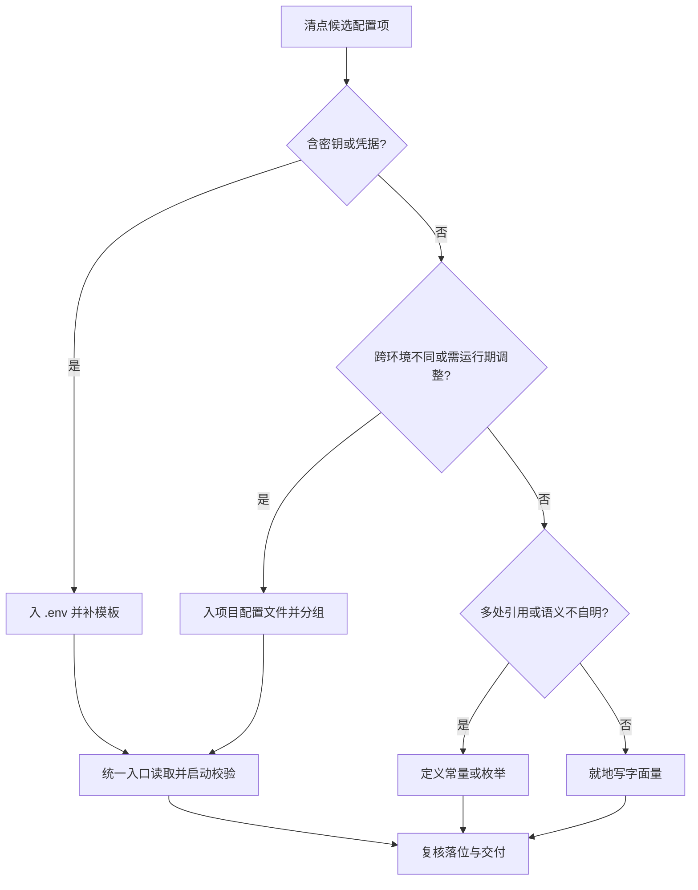

# 服务端配置放置规则

按下图推进，逐节点落实其细则。

## 配置分流流程



## S1 配置项清点

1. S1：动笔前把本次涉及的可变值列成清单，逐项走完 D1 到 D3 再写实现；禁止边写实现边决定放置位置。

2. S1：清点范围覆盖外部服务地址与端点、凭据、超时、重试次数、并发与批量大小、文件与目录路径、功能开关、业务阈值、格式与编码、状态取值集合。

3. S1：动笔前从仓库现有文件确认项目已在用的配置格式、配置文件位置和读取入口，本次一律沿用；仓库无既有约定时凭据用 `.env`，其余配置用 `.yaml`。

4. S1：项目用 `.env`、`.yml`、`.yaml`、`.ini`、`.toml` 中的哪一种，就把新配置项按该格式的语法写进既有文件；禁止因为不熟悉既有格式而另建一份自己习惯的配置文件。

   > 反例：项目已有 `config.ini`，仍新建 `config.yaml` 承载新配置项，形成两套并存的配置。

5. S1：仓库同时存在多种配置文件、无法判断哪一份生效、或既有文件的读取入口找不到时，先向用户确认目标文件与格式，得到答复前禁止新建或改写任何配置文件。

## D1-S2 密钥与凭据

6. D1：口令、令牌、API Key、私钥、证书口令、含账号密码的连接串一律判为凭据，只写入 `.env` 并由配置模块从该文件读取。

7. S2：凭据禁止出现在会提交进版本库的任何文件里；提交的配置文件只保留不含凭据的部分。

   > 示例：
   > ```yaml
   > db_dsn: "postgresql://app:P@ssw0rd@db:5432/app"  # 禁止
   > db_dsn: "postgresql://app@db:5432/app"           # 用；口令由 .env 的 DB_PASSWORD 提供
   > ```

8. S2：新增凭据键时同步在 `.env.example` 补同名键、空值和一行用途注释，并确认 `.gitignore` 已忽略 `.env`。

9. S2：各部署环境的 `.env` 由部署流程单独放置到运行目录，禁止随代码仓库和镜像分发。

10. S2：凭据只在配置入口处读取，禁止打印、写日志、拼进异常信息和错误响应。

## D2-S3 配置文件

11. D2：只有取值在开发、测试、生产之间不同，或已有明确的运维、灰度、业务诉求要求不改代码就能调整时，才判为配置文件项。

12. D2：判定依据只取已经存在的诉求；禁止以「将来可能要改」「做成可配置更灵活」为由把值放进配置文件。

13. S3：全量环境取值相同且从未被调整过的值禁止进配置文件，改为常量或字面量。

    > 反例：把 `date_format: "%Y-%m-%d"`、`log_format`、`page_size: 20` 做成配置项，各环境取值完全一致。

14. S3：程序内部结构禁止进配置文件，包括字段映射表、状态取值集合、SQL 片段、路由路径、提示词与模板文本、错误码文案；这些随代码一起变更，用常量或枚举承载。

15. S3：控制分支走向的开关只在需要按环境或灰度切换时才进配置文件；仅为兼容旧逻辑保留的开关直接删除对应分支。

16. S3：配置项按业务域分组，层级不超过两层，键名带单位后缀；禁止把全部键平铺成一大段。

    > 示例：
    > ```yaml
    > ocr:
    >   endpoint: "https://api.example.com/ocr"
    >   timeout_seconds: 10
    > ```

17. S3：配置文件只写需要覆盖的键，默认值留在代码的配置模型里；禁止把全部键连同默认值抄进每个环境的配置文件。

18. S3：环境差异用按环境命名的独立配置文件表达，加载哪一份由 `.env` 中的环境标识决定；禁止在单个配置文件内写按环境判断的条件段落。

19. S3：配置项的值只用标量、列表和简单映射；禁止写入表达式、类路径和可执行片段。

    > 反例：`handler: "app.services.ocr:BaiduHandler"`，由配置动态导入实现类。

## D3-S4-S5 常量与字面量

20. D3：同一值在两处及以上出现，或单看字面量无法判断含义时，定义为具名常量。

21. D3：值只在一个函数内出现且含义由上下文自明时直接写字面量；禁止为它新建常量。

    > 正例：`chunk = data[:2]`、`mb = size / 1024 / 1024`。

22. D3：字面量出现在条件判断或分支阈值中且含义不自明时，即使只有一处也提为常量。

    > 反例：`if code == 4029:`；正例：`if code == RATE_LIMIT_ERROR_CODE:`。

23. S4：常量就近定义在使用它的模块顶部；两个及以上模块共用时才上提到所在包的 `constants.py`，禁止建一个收纳全项目常量的全局文件。

24. S4：一组互斥取值用 `Enum` 或 `StrEnum` 定义，禁止用并列的字符串常量表达同一集合。

    > 示例：
    > ```python
    > STATUS_PENDING = "pending"          # 禁止
    > STATUS_DONE = "done"
    >
    > class TaskStatus(StrEnum):          # 用
    >     PENDING = "pending"
    >     DONE = "done"
    > ```

25. S4：常量名用 `UPPER_SNAKE_CASE` 并带单位或量纲后缀。

    > 示例：`REQUEST_TIMEOUT = 10` 禁止；`REQUEST_TIMEOUT_SECONDS = 10` 用。

26. S4：常量只放不可变字面值、元组和 `frozenset`；需要运行期求值或依赖外部状态的值放配置模型或函数，禁止在模块导入期执行 I/O。

## S6 读取与校验

27. S6：`.env` 与配置文件由一个配置模块统一加载成配置对象，业务代码只从该对象取值；禁止在业务模块中直接读文件或调用 `os.getenv`。

    > 示例：
    > ```python
    > timeout = int(os.getenv("OCR_TIMEOUT", "10"))   # 禁止
    > timeout = settings.ocr.timeout_seconds          # 用
    > ```

28. S6：配置项的取值来源固定为 `.env` 与项目配置文件；禁止把某个配置项设计成只能由进程环境变量注入，也禁止在两处重复定义同一项。

29. S6：每个配置项在配置模型中声明类型和默认值，加载时完成类型转换与取值合法性校验。

30. S6：必填且无合理默认的配置项在进程启动时校验，缺失或非法直接抛异常终止启动；禁止延迟到首次调用才暴露，禁止静默回退到内置默认值。

31. S6：配置对象在启动时构造一次并显式传入需要它的组件；禁止在函数内部随取随读，禁止运行期修改配置对象。

32. S6：启动时记录生效配置只输出非敏感项，凭据类字段一律脱敏或省略。

## S7 复核与交付

33. S7：复核每个候选项恰好落在一层，且旧位置的定义、读取代码和模板条目已同步删除。

34. S7：复核常量作用域，只被一个模块使用的常量从共享常量文件下沉回该模块。

35. S7：交付说明列出本次新增或改动的配置项、所在层级、默认值，以及需要在部署环境的 `.env` 中补齐的键。

## 全局约束

36. 判定卡在配置文件与常量之间时按常量落地，并在交付说明中标注该项；禁止以拿不准为由默认放进配置文件。

37. `.env` 键名用 `UPPER_SNAKE_CASE` 并统一加项目前缀，配置文件键名用 `lower_snake_case`，两者都与配置模型中的字段一一对应。

38. 只调整本次需求涉及的配置项；禁止顺带迁移、重命名或重排既有配置。
