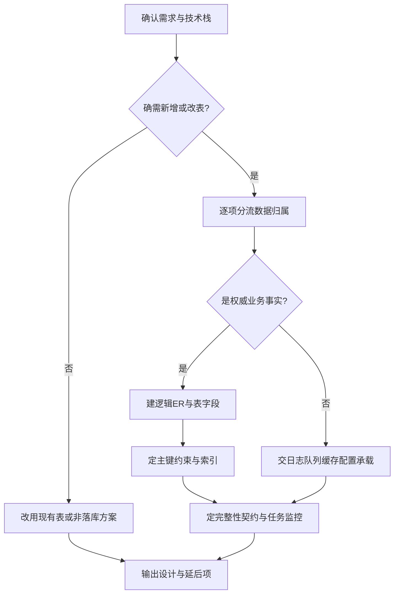

# 数据库表设计规则

按下图推进，逐节点落实其细则。

## 建表流程



## S1-S2 需求与建表判定

1. S1：动笔前确认业务对象、写入方、读取方、查询与筛选路径、保留与恢复需求、并发与幂等要求，缺失项按合理假设推进并写明假设。

2. S1：动笔前从代码与配置确认项目实际使用的数据库、消息队列组件、缓存组件、进程管理器与日志方案，后续规则一律落到这些既有组件上；确认不到时写明所需组件类别与替代前提。

3. S1：只对会实质改变表结构的缺失信息发问，其余先给假设再推进。

4. D1：现有表通过加字段、加状态或直接复用即可承载新业务时不新建表；只有新业务对象具备独立生命周期、独立写入方、独立查询路径时才新建表。

5. S2：判定为不需要建表时给出替代承载方案，写明复用哪张表、补哪些字段，或改由哪类非落库方式承载，禁止只回答「不需要建表」。

## S3-S4 数据归属分流

6. S3：把每项候选数据逐项分流到数据库、消息队列、缓存、配置、日志、代码六者之一，禁止未分流就直接写进字段清单。

7. D2：同时满足「进程重启后仍需存在」「有明确的产品或业务读取方」「无法由已有事实可靠派生」三条时才判为权威业务事实并落库，否则进入 S4。

   > 反例：`last_heartbeat_at` 只用于排障，应写日志；正例：`submitted_at` 是产品页面要展示的业务事实，应落库。

8. S4：错误堆栈、外部调用诊断、中间执行细节、原始调试载荷、链路追踪标识一律写结构化日志，禁止为它们建表或加字段。

9. S4：任务分发、消费确认、重试调度、并发限流、延迟触发交项目既有消息队列组件承载，禁止在数据库中自建队列表或调度表轮询。

   > 反例：建 `task_queue` 表由 worker 轮询待处理记录；正例：消息投递给队列组件，库中只保留业务结果。

10. S4：会话态、令牌、限流计数、幂等键、短时锁、热点只读快照交项目既有缓存组件承载并设置过期时间，禁止落库。

11. S4：阈值、超时、重试上限、模型名称、服务端点、功能开关、运行策略写配置文件或环境变量；只有确认需按租户或用户维度差异化，或需版本管理与审计时才落库。

12. S4：校验、编排、状态转换、去重、临时计算只写代码，禁止为保存中间计算结果建表。

13. S3：能由已有字段可靠派生的值默认不落库；仅当已确认的查询、一致性、审计或实测性能需求成立时才物化，并同时定义来源字段、重算事件、写入责任方与回填路径。

14. S3：新增字段必须能说明写入方、写入事件、读取方、读取场景、事实来源、保留规则，以及无法靠派生、日志或配置满足的原因；六项说不全的字段一律延后。

15. S3：一个状态字段只表达一个生命周期，取支撑当前状态转换、界面、恢复与报表的最小状态集合；同一生命周期状态禁止在多张表重复存储，改由权威表单点维护。

    > 反例：`status` 同时表达审批进度与支付进度；正例：拆成 `approval_status` 与 `payment_status`。

16. S3：历史变化需被用户、审计方或业务规则查询时才建历史表，并同时定义读取方、事件粒度、保留期限与还原要求；仅用于排查问题的变更轨迹写日志。

17. S3：审计字段按项目约定统一，默认只保留创建时间与更新时间；无明确读取需求时禁止加操作人、版本号、删除元数据。

## S5 逻辑关系与表字段

18. S5：先输出逻辑 ER 模型再落物理表；每条关系记录来源实体、目标实体、基数、必选或可选参与、承载关系的标识符字段、重新关联策略、删除与失效行为。

19. S5：每张 ER 图与关系表必须标注「仅表示逻辑关系，不创建物理外键」。

20. S5：关系一律用 `task_id`、`user_id` 这类普通标识符字段表达；禁止 `FOREIGN KEY`、`REFERENCES`、`ForeignKey`、`ForeignKeyConstraint`、`op.create_foreign_key` 以及 `ON DELETE CASCADE`、`ON DELETE SET NULL`、`ON UPDATE CASCADE` 等引用操作，完整性改由规则 33 起的业务层契约保障。

    > 示例：
    > ```sql
    > submission_id BIGINT NOT NULL REFERENCES homework_task(id)  -- 禁止
    > submission_id BIGINT NOT NULL                               -- 用
    > ```

21. S5：用户给出的方案含物理外键时，指出冲突并改写为普通标识符字段加业务层契约；禁止把「是否使用外键」表述为待权衡的选项。

22. S5：多对多关系仅在关系本身是持久业务事实或带自身属性时建关系表，两侧同样只存普通标识符字段。

23. S5：交付中禁止出现 ORM `relationship()`、`back_populates`、`backref` 等关系导航设计，改在业务层契约中说明关联查询职责。

24. S5：一张表只承担一项内聚业务职责，并说明用途、数据来源、创建与更新时机、主要查询路径、保留策略。

25. S5：每个字段给出字段名、关系型数据类型、可空性、默认值语义、业务含义，并标明是否为普通关系标识符。

26. S5：禁止推测性字段、通用 JSON 容器、预留扩展表以及 `owner_type` 加 `owner_id` 式多态组合；确有跨实体归属需求时改用独立关系表并写明其完整性代价。

## S6 主键、约束与索引

27. S6：每张表按项目约定定义稳定主键；主键与对外业务标识符生命周期不同时拆成两个字段。

28. S6：逻辑相关的标识符字段必须类型与有无符号属性一致。

29. S6：字段在记录层面不允许缺失时用 `NOT NULL` 并给默认值语义，禁止用空串或哨兵值代替。

30. S6：只有必须在并发写入下保持成立的稳定业务不变量才加唯一约束，并写明字段组合、`NULL` 处理方式、大小写敏感性及与软删除的相互影响；禁止用唯一约束模拟逻辑父子关系。

31. S6：只有有边界的数值范围、允许的字段组合这类稳定行内不变量才用 `CHECK`；跨表规则与易变流程策略放业务层校验。

32. S6：每个索引必须写明其支撑的筛选、关联、排序、分页或唯一性访问路径与预期数据规模；禁止因字段名以 `_id` 结尾就加索引，禁止为假设中的未来查询加索引。

    > 反例：`homework_task_id` 带 `_id` 后缀所以建索引；正例：列表页按 `homework_task_id` 筛选并分页，故建索引。

## S7 完整性契约与任务监控

33. S7：为每条逻辑关系定义创建子记录、重新关联子记录、更新父记录、删除父记录、读取子记录、并发写入六个事件的业务层处理规则与责任方。

34. S7：删除父记录必须从拒绝删除、软删除、归档、解除关联、业务级联中明确选定一种，禁止留空。

35. S7：必须写明孤儿记录的检测方式与修复动作，并指出绕过正常业务入口的写入与竞态仍可能产生孤儿数据。

36. S7：契约只写校验点、事务边界、幂等要求与责任方，实现留给后续编码环节，禁止在本次交付中写 Service、Repository、ORM model、迁移或查询代码。

37. S7：异步任务与定时任务默认不建任务表；执行轨迹、耗时与失败原因写结构化日志，进程存活与异常退出交项目既有进程管理器监控并告警。

    > 正例：对账任务每轮写一条含耗时与处理条数的日志，进程退出由进程管理器拉起并告警，库中不建 `job_run` 表。

38. S7：崩溃恢复、幂等去重、产品可见进度、运维查询、审计报表任一需求成立时才建任务表，且按业务任务粒度建模，禁止为每次内部调用、每次重试、每次队列投递单独建记录。

39. S7：`attempt_count`、`next_retry_at`、`last_error_code`、`last_error_message`、`error_stack`、`error_payload` 各自对应明确的产品、运维、恢复或报表用途时才允许落库，否则写日志。

40. S7：定时任务的执行时间、结果与耗时默认由日志和监控告警覆盖；只有业务需按次查询或对账时才落表。

## S8 交付内容

41. S8：交付内容依次为业务假设与范围、数据归属决策、逻辑 ER 模型、表职责、字段定义、主键与约束与索引及其依据、业务层完整性契约、状态与生命周期定义、延后项、风险。

42. S8：字段映射与关系映射用表格表达；仅当逻辑拓扑比表格明显更清晰时才用 Mermaid。

43. S8：延后项必须逐条列出并写明触发添加它的具体信号，避免被后续读者当成遗漏。

44. S8：用户明确要求 DDL 时才输出 DDL，且不得包含外键与引用操作。

## 全局约束

45. 逐项质疑每张新表、每个字段、每个状态、每个约束、每个索引：说不出当前需求、写入方与读取方的一律删除或转为延后项。

46. 设计范围只覆盖用户当前需求；未来功能能通过安全迁移添加时一律延后，禁止预建表与预留字段。

47. 交付说明写明新增或修改了哪些表与字段、哪些数据判定为不落库及其承载方式、延后项清单、遗留的一致性与孤儿数据风险。
