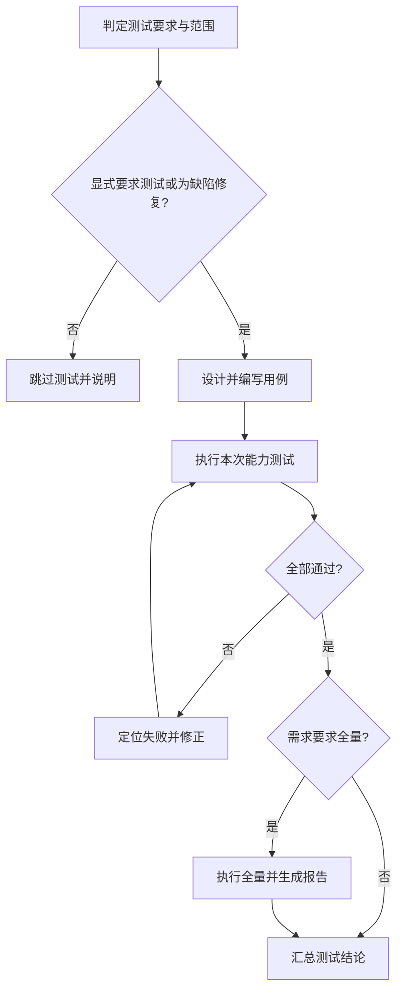

# Pytest 测试规则

按下图推进，逐节点落实其细则。

## 测试流程



## S1 触发判定与范围

1. S1：需求文本出现「测试」「单测」「单元测试」「接口测试」「用例」「pytest」「验证」「覆盖」任一词时，判定为要求测试。

2. S1：需求为修复缺陷、报错或异常行为时，即便未出现上述词也判定为要求测试，并必须包含一条在旧实现上稳定复现该缺陷的回归用例。

3. S2：规则 1 与规则 2 的判定都不成立时只交付生产代码，在交付说明中写一句「本次未编写测试」，禁止顺带新增或修改任何测试文件与测试配置。

4. S1：测试范围只覆盖本次变更触及的公开入口，禁止为未改动的模块补测试。

5. S1：项目已有 `tests/` 布局、`conftest.py`、Marker 与执行命令时一律沿用，禁止搬迁既有结构。

## S3 用例设计与编写

6. S3：按本次变更的最高公开入口选层级；改动独立工具、CLI、MCP Tool 时写功能测试；改动 Service、纯函数、业务规则时写单元测试；改动 HTTP endpoint 时同时写接口测试与其内部 Service 单元测试；改动 Repository 或持久化逻辑时写 Repository 测试。

7. S3：只从公开入口调用被测对象；禁止为覆盖率直接调用 `_load_image()` 一类私有实现。

8. S3：独立工具内含复杂且可独立表达的业务规则时，在公开入口功能测试之外再补该规则的单元测试；禁止仅因内部函数多就逐个测试。

9. S3：每个被测公开能力至少覆盖一个正常场景、一个异常场景、一个有业务意义的边界场景。

10. S3：新增 endpoint 至少覆盖成功响应、请求校验或业务错误响应、一条路由到 Service 的真实接线用例。

11. S3：错误场景必须断言确定的异常类型、错误码、HTTP 状态码或响应体字段。

    > 示例：
    > ```python
    > assert response.status_code != 200        # 禁止
    > assert response.status_code == 422        # 用
    > assert response.json()["msg"] == "请求参数校验失败"
    > ```

12. S3：多组等价输入用 `pytest.mark.parametrize`，禁止复制粘贴同构用例。

13. S3：被测对象为 `async def` 时用 `async def` 测试函数直接 `await` 调用；被测对象为 `def` 时用同步测试函数，禁止把同步调用包进 `asyncio.run` 或自建事件循环。

14. S3：异步测试统一用 `pytest-asyncio`；`pyproject.toml` 未声明该依赖时先加入开发依赖组，并在 `[tool.pytest.ini_options]` 配 `asyncio_mode = "auto"`。

    > 示例：
    > ```toml
    > [tool.pytest.ini_options]
    > asyncio_mode = "auto"
    > ```

15. S3：`asyncio_mode = "auto"` 生效后禁止再逐个标注 `@pytest.mark.asyncio`。

16. S3：FastAPI 接口测试中，路由函数为 `def` 时用 `fastapi.testclient.TestClient`；路由函数为 `async def` 或用例需要 `await` 应用内协程时用 `httpx.AsyncClient` 配 `ASGITransport`；两者都不启动真实 Uvicorn。

    > 示例：
    > ```python
    > async with AsyncClient(transport=ASGITransport(app=app), base_url="http://test") as client:
    >     response = await client.post("/api/v1/images/precheck", files=valid_image_form)
    > ```

17. S3：替换 `async def` 依赖时用 `unittest.mock.AsyncMock` 或 `async def` Fake，禁止用返回普通值的 `MagicMock`。

18. S3：异步 Fixture 用 `pytest_asyncio.fixture` 声明，禁止在同步 Fixture 中创建或关闭事件循环。

19. S3：项目无既有布局时，测试按 `tests/` 下 `functional/`、`api/`、`services/`、`repositories/`、`fixtures/`、`report-doc/` 分类存放，跨文件共享的 Fixture 放 `tests/conftest.py`。

20. S3：同一业务、Service、工具或 endpoint 的用例用类分组，类名用 `Test{名称}Functional`、`Test{名称}Service`、`Test{名称}Api`、`Test{名称}Repository`；测试类禁止持有可变共享状态。

21. S3：测试函数名写成 `test_{行为}_{预期结果}`，描述可观察行为。

    > 正例：`test_precheck_returns_error_when_image_is_blurry`；反例：`test_case_1`。

22. S3：项目缺少 pytest 配置时在 `[tool.pytest.ini_options]` 补 `testpaths`、`pythonpath` 与 `functional`、`unit`、`api`、`repository`、`slow`、`external` 六个 Marker，并给每个测试类标注对应 Marker。

23. S3：app、client、数据库会话、测试用户、样本文件等多处复用的准备逻辑沉淀为 Fixture，命名用 `api_client`、`mock_image_repo` 一类业务语义名；只在单文件使用的 Fixture 留在该文件内。

24. S3：数据库 Fixture 必须事务回滚或测试后清理，禁止连接生产数据库。

25. S3：OCR、LLM/VLM、对象存储、邮件、短信、第三方 API 一律用 Fake、`monkeypatch` 或 `unittest.mock` 替换；确需真实调用时给该用例标 `external`。

26. S3：Repository 测试用隔离测试库，禁止 Mock ORM 查询本身；API 测试可 Mock Service，但必须保留至少一条不 Mock 的真实接线用例。

27. S3：禁止 Mock 被测对象自身或扩大 Mock 范围绕过业务逻辑；只在需要断言调用参数或注入异常时使用 `unittest.mock`。

28. S3：第三方测试依赖只允许 `pytest`、`pytest-asyncio`、`httpx`；禁止引入 `requests`、`pytest-mock`、`respx`、`hypothesis`、`locust`。

## S4 执行与失败处理

29. S4：新写或修改单个用例时只运行该用例。

    > 示例：`uv run pytest tests/services/test_image_tool.py::TestImageToolFunctional::test_extract_success`

30. S4：当前能力写完后运行其对应测试文件；接口与内部 Service 同时变化时分别运行两个文件。

31. S4：项目不用 `uv` 时换成项目既有的 pytest 执行方式，禁止使用项目未注册的 Marker 造成伪失败。

32. D2：存在失败或错误用例时一律进入 S5，禁止在未全绿时汇总结论或执行全量。

33. S5：先把失败归因为测试代码错误、测试环境问题、既有无关失败、本次生产缺陷四者之一，再动手修改。

34. S5：原需求包含实现或修复授权时才可改生产代码；需求只要求测试时，发现生产缺陷先报告，禁止静默修复。

35. S5：禁止删除用例、追加 `skip`、弱化断言或扩大 Mock 来换取通过。

36. S5：每次修正后先重跑失败用例，通过后再跑对应文件，禁止直接跳到更大范围。

37. S5：无法解决时保留失败输出，说明阻塞原因、影响范围与下一步动作，禁止把未解决的失败描述为通过。

## S6 全量与报告

38. D3：需求文本出现「全量」「回归」「全部测试」「整体测试」「跑一遍所有」任一词时才执行全量，否则直接进入 S7。

    > 反例：因为改动看起来影响面大就自行升级为全量；范围只由需求文本决定。

39. S6：全量执行用 `uv run pytest -m "not external and not slow"`，`external` 与 `slow` 保持排除并在报告中列为未覆盖范围。

40. S6：全量执行后在 `tests/report-doc/pytest-report-YYYYMMDD-HHMMSS.md` 写报告，内容依次为执行时间与命令、执行环境与 Commit、通过与失败与错误与跳过数及耗时、实际测试范围、失败用例及原因、未覆盖范围、风险与后续动作。

41. S6：报告的描述、结论、风险与后续动作用中文，命令、路径、类名、Marker、异常名、状态码、依赖名保留英文。

42. S6：本地全量确实不可行时执行受影响测试集，并在报告与交付说明中写明「本地未执行全量测试」，禁止写「全部测试通过」。

43. S7：未经过 S6 时禁止生成任何报告文件，结论只写在交付说明中。

## 全局约束

44. 只编写测试代码与必要的测试配置；禁止借测试之名重构与本次变更无关的生产代码。

45. 禁止把测试扩大到性能、压力、安全、前端 E2E 或真实第三方集成。

46. 交付说明写明新增或修改了哪些测试文件、实际执行的命令与结果、是否执行全量及报告路径、测试暴露并处理了哪些问题、遗留的失败与跳过。
