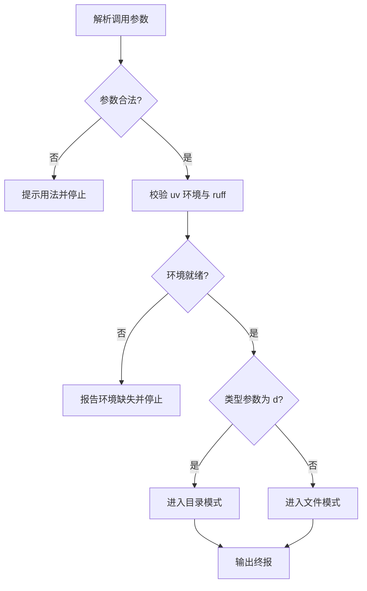
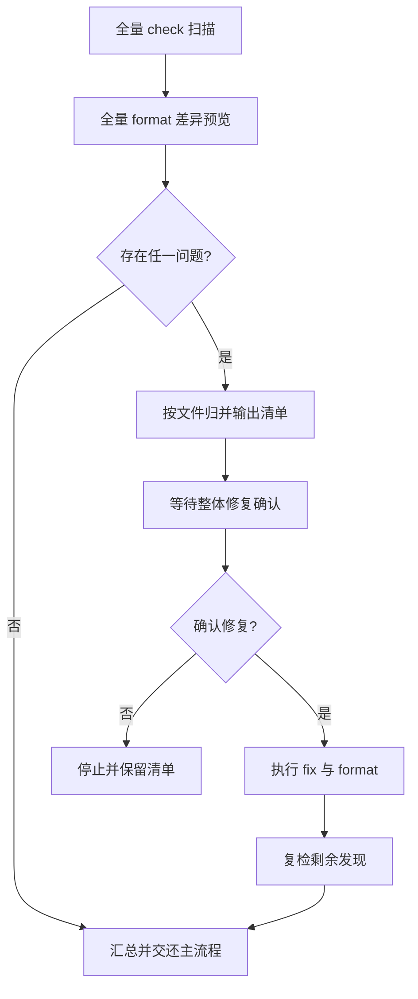
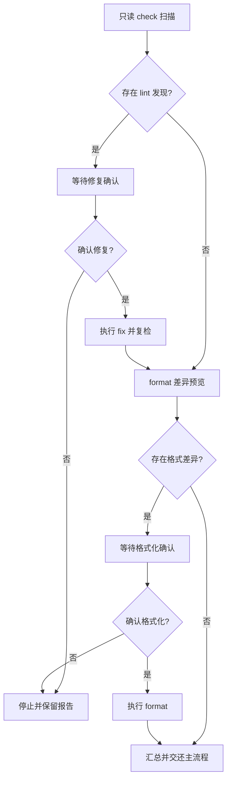

# Ruff 检查与格式化

按下图推进，逐节点落实其细则。

## 调用流程

## S1 参数解析

1. S1：调用格式固定为 `<类型> <相对路径>` 两个参数，类型只接受 `d` 与 `f`，`d` 后跟目录，`f` 后跟文件。

2. D1：参数个数不为二、类型不是 `d` 或 `f`、类型与路径实际种类不符时，输出一行用法并停止，禁止推断用户意图。

   > 示例：`用法：$ruff-check-format d <相对目录> | f <相对文件>`

3. S1：把工具工作目录视为项目根，除非用户在调用中显式给出其他项目根。

4. S1：只接受项目根内的相对路径；绝对路径、空路径、含 `..` 的路径以及逃出项目根的路径一律拒绝并停止。

5. S1：目标不存在时报告解析出的实际路径并停止，禁止改用邻近路径重试。

## S3 环境校验

6. S3：Ruff 一律用项目本地虚拟环境中的可执行文件，POSIX 用 `./.venv/bin/ruff`，Windows 用 `.\.venv\Scripts\ruff.exe`。

7. S3：进入后续节点前先运行 `./.venv/bin/ruff --version` 确认可执行文件可用。

8. D2：`.venv` 不存在时报告 `当前项目无 uv 虚拟环境，已停止，未使用全局环境。` 并停止。

9. D2：虚拟环境中未安装 Ruff 时报告 `当前 uv 虚拟环境中未安装 ruff。可安装后重试，例如：uv add --dev ruff` 并停止。

10. S3：禁止运行 `ruff`、`python -m ruff`、`uvx ruff`、`uv tool run ruff`、`pipx ruff` 以及任何全局或其他环境中的 Ruff。

11. S3：禁止运行 `uv sync`、`uv venv`、`uv add`、`uv pip install`；缺环境或缺依赖时只报告并停止，由用户自行安装。

## S5 目录模式

12. S8：运行 `./.venv/bin/ruff check --output-format=json -- <相对目录>` 全量扫描；退出码非零但带有发现时视为有效输出，不当作命令失败。

13. S9：运行 `./.venv/bin/ruff format --diff -- <相对目录>` 只预览差异，本节点禁止写入文件。

14. S10：清单按文件归并，每个文件给出 lint 发现数、其中可自动修复数、是否存在格式差异；涉及文件超过 20 个时只列前 20 个并附总数。

15. S10：清单禁止粘贴完整 diff；仅当单个文件的 diff 短于 20 行时可一并附上。

16. D5：目录模式只设这一道门控，确认一次即覆盖 lint 修复与格式化，中途不再追加询问。

17. S13：先运行 `./.venv/bin/ruff check --fix -- <相对目录>`，再运行 `./.venv/bin/ruff format -- <相对目录>`，顺序不可颠倒。

18. S14：复检重跑只读 `check`，报告剩余发现与实际被格式化的文件数。

19. S12：用户拒绝时不执行任何写入命令，原样保留清单供下次调用。

## S6 文件模式

20. S16：运行 `./.venv/bin/ruff check --output-format=json -- <相对文件>`，逐条报告规则代码、行列、消息以及 Ruff 是否标记为可自动修复。

21. S19：确认后运行 `./.venv/bin/ruff check --fix -- <相对文件>`，随后重跑只读扫描并报告剩余发现。

22. S20：运行 `./.venv/bin/ruff format --diff -- <相对文件>`；diff 为空时报告未发现 format 变更。

23. S22：确认后运行 `./.venv/bin/ruff format -- <相对文件>`，并报告本次改动范围。

24. S18：文件模式两道门控中任意一道被拒绝，立即终止整个流程，不再进入后续节点。

## 全局约束

25. 确认必须是显式表述，如 `确认 fix`、`执行 fix`、`修复`、`确认 format`、`格式化落地` 或语义同样明确的说法；沉默、含糊同意、要求"再看细节"一律不作数。

26. 用户表示停止、暂停、取消、否定，或只要求查看报告时，禁止执行任何写入文件的命令。

27. 作用范围严格限定为参数给定的文件或目录；用户未明确扩大范围时，禁止波及父目录、同级包或整个项目。

28. 目录模式递归处理子目录，并沿用项目 Ruff 配置中的 exclude 规则；禁止自行增删排除项。

29. 遵循项目现有 Ruff 配置；禁止自行追加 `--select`、`--ignore`、`--line-length` 等选项，用户明确要求时除外。

30. 报告依次给出：项目根、模式与目标、环境状态、lint 发现或 `未发现 lint 问题`、format 差异摘要或 `未发现 format 问题`、下一步需要用户做的决定。

31. 报告只写事实与待决动作；禁止转述命令输出全文、解释 Ruff 规则含义或评价代码风格。
