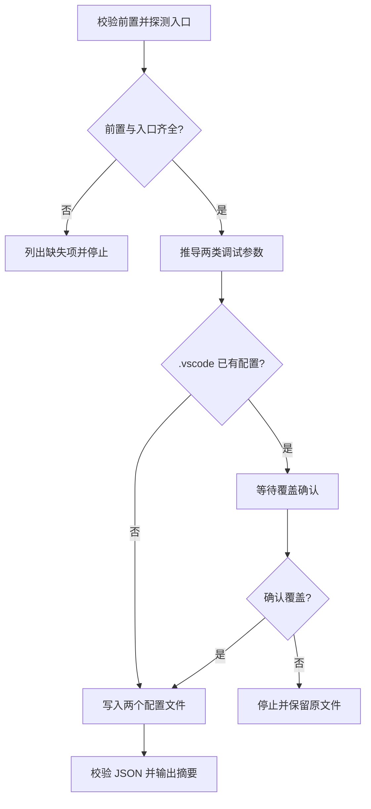

# uv + FastAPI 项目 VS Code 配置

按下图推进，逐节点落实其细则。

## 生成流程



## S1 前置校验与入口探测

1. S1：依次确认 `pyproject.toml` 存在且含 `[project]`、`uv.lock` 存在、`.venv/` 存在、`fastapi` 出现在 `[project]` 的依赖声明或 `uv.lock` 中。

   > 反例：把 `[tool.uv]` 缺失当作不是 uv 项目；该节是可选配置，是否为 uv 项目以 `uv.lock` 为准。

2. D1：任一前置项缺失时列出全部缺失项及对应处理动作并停止，禁止代为执行 `uv sync`、`uv venv` 或任何安装命令。

   > 示例：`缺少 .venv/：先执行 uv sync。`

3. S1：入口文件按 `src/main.py` → `app/main.py` → `main.py` 顺序查找并取首个命中，禁止搜索其他路径。

4. S1：命中文件必须含由 `FastAPI(` 创建的模块级实例；实例变量名从代码中读取，禁止默认写死 `app`。

5. D1：三个候选路径都不存在，或命中文件无模块级 FastAPI 实例时，报告已查找的路径并停止。

## S3 调试参数推导

6. S3：解释器路径按目标项目所在平台取值，POSIX 用 `${workspaceFolder}/.venv/bin/python`，Windows 用 `${workspaceFolder}/.venv\Scripts\python.exe`。

7. S3：入口模块名由入口文件相对工作区根的路径推导，去掉 `.py` 后把路径分隔符换成点，再以冒号拼接实例变量名。

   > 示例：`src/main.py` + `app` → `src.main:app`；`main.py` + `application` → `main:application`。

8. S3：入口文件含 `uvicorn.run(...)` 且带字面量 `host=` / `port=` 时，把值追加为 `--host <host>`、`--port <port>`；无字面量时这两项都不写。

9. S3：`host` 或 `port` 来自变量、环境读取或配置对象时，一律不写入 `args`，并在摘要中说明未解析。

10. S3：两个调试配置的 `cwd` 都固定为 `${workspaceFolder}`，禁止指向入口文件所在子目录。

11. S3：单模块调试用 `module` 字段接 `${input:debugModule}`，禁止改用 `program` 或写死具体文件路径。

12. S3：单模块调试等价于在工作区根执行 `python -m <包名>`；包名用点分隔、基准为工作区根、不带 `.py` 后缀。

13. S3：`inputs` 只声明一个 `promptString`，`id` 固定为 `debugModule`，`description` 内嵌一个由本项目实际目录结构推出的示例包名。

    > 示例：入口为 `src/main.py` 时写 `要调试的完整包名，如 src.services.user.handler`。

## S6 写入配置

14. D2：`.vscode/settings.json` 或 `.vscode/launch.json` 已存在时，先列出将被覆盖的文件名并等待确认。

15. D3：确认必须是 `确认覆盖`、`覆盖` 或语义同样明确的显式表述；未确认时原样保留既有文件并停止，禁止改名备份、禁止与既有内容合并。

16. S6：只写 `.vscode/settings.json` 与 `.vscode/launch.json` 两个文件，内容按《输出模板》原样落地。

17. S6：模板中需替换的占位项只有解释器路径、`<入口模块>`、`<实例名>` 与输入框示例包名，其余键值原样保留。

18. S6：`.vscode/` 不存在时创建该目录；禁止改动 `.gitignore`、`pyproject.toml` 及任何源码文件。

19. S6：`launch.json` 固定包含 `Backend` 与 `Module` 两个配置，顺序为先 `Backend` 后 `Module`。

20. S6：JSON 内禁止写注释与尾随逗号。

## S7 校验与摘要

21. S7：用 `python3 -m json.tool` 分别校验两个文件；解析失败时报告失败文件与错误位置并停止。

22. S7：摘要依次给出解释器路径、入口模块与实例名、host/port 判定依据、两个配置名与各自用途、是否覆盖了既有文件。

23. S7：`.env` 缺失时在摘要末尾提示一行；禁止代为创建 `.env` 或填充其内容。

## 全局约束

24. 只生成配置文件；禁止安装依赖、创建或修改虚拟环境、启动服务、发起调试会话。

25. 平台判定按目标项目所在系统，只写入一套解释器路径。

26. 遵循项目既有配置；用户未要求时禁止在 `settings.json` 中追加格式化器、linter、测试框架等设置项。

27. 摘要只写事实与待决动作；禁止解释 VS Code 字段含义、推荐插件或评价项目结构。

## 输出模板

`settings.json`：

```json
{
  "python.defaultInterpreterPath": "${workspaceFolder}/.venv/bin/python",
  "python.terminal.activateEnvironment": true
}
```

`launch.json`：

```json
{
  "version": "0.2.0",
  "configurations": [
    {
      "name": "Backend",
      "type": "debugpy",
      "request": "launch",
      "module": "uvicorn",
      "args": ["<入口模块>:<实例名>", "--reload"],
      "cwd": "${workspaceFolder}",
      "console": "integratedTerminal"
    },
    {
      "name": "Module",
      "type": "debugpy",
      "request": "launch",
      "module": "${input:debugModule}",
      "cwd": "${workspaceFolder}",
      "console": "integratedTerminal"
    }
  ],
  "inputs": [
    {
      "id": "debugModule",
      "type": "promptString",
      "description": "要调试的完整包名，如 src.services.user.handler",
      "default": ""
    }
  ]
}
```
