# RabbitMQ 简明介绍

RabbitMQ 是一个消息队列中间件。它的核心作用是把“发送消息的一方”和“处理消息的一方”解耦：生产者只负责把消息发出去，消费者按自己的处理能力从队列中取消息处理。

本文只介绍消息队列场景，不包含 RPC 用法。

## 核心实体

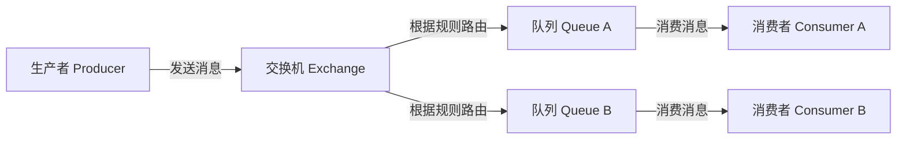

### 生产者

生产者负责创建消息并发送到 RabbitMQ。

生产者通常不会直接把消息发给消费者，而是把消息发送给交换机，由交换机决定消息进入哪个队列。

### 消费者

消费者负责从队列中获取消息并处理业务逻辑。

一个队列可以有一个消费者，也可以有多个消费者。多个消费者消费同一个队列时，RabbitMQ 会把队列中的消息分发给不同消费者处理。

### 交换机

交换机负责接收生产者发送的消息，并根据规则把消息转发到一个或多个队列。

常见交换机类型：

- `direct`：按完全匹配的 `routing_key` 路由消息。
- `fanout`：广播消息到所有绑定的队列，忽略 `routing_key`。
- `topic`：按通配符规则匹配 `routing_key`，适合分层主题。
- `headers`：按消息头匹配，使用较少。

### 队列

队列用于存放消息。消费者从队列中取消息进行处理。

如果消费者暂时处理不过来，消息可以先留在队列中等待处理。队列是 RabbitMQ 中实现“削峰填谷”的关键实体。

### 绑定关系

绑定是交换机和队列之间的关系。

交换机本身不保存消息，它需要通过绑定关系知道应该把消息转发到哪些队列。

队列绑定到交换机时可以带一个 `binding_key`。`binding_key` 也经常被口语化叫作 `bind key`，表示这个队列希望接收哪类消息。

### 路由键

`routing_key` 是生产者发送消息时携带的路由信息。

在 `direct` 和 `topic` 类型交换机中，RabbitMQ 会根据 `routing_key` 和绑定规则判断消息应该进入哪些队列。

需要注意：

- 生产者没有 `binding_key`，生产者发送消息时使用的是 `routing_key`。
- 队列没有 `routing_key`，队列绑定交换机时使用的是 `binding_key`。
- 消息能不能进入某个队列，取决于交换机类型如何匹配 `routing_key` 和 `binding_key`。

不同交换机的匹配方式：

| Exchange 类型 | 匹配规则 |
|---|---|
| `direct` | `routing_key` 和 `binding_key` 完全相同才投递 |
| `topic` | `routing_key` 和 `binding_key` 按通配符规则匹配 |
| `fanout` | 忽略 `routing_key` 和 `binding_key`，广播给所有绑定队列 |
| 默认交换机 | `routing_key` 通常写队列名 |

## 消息流转过程

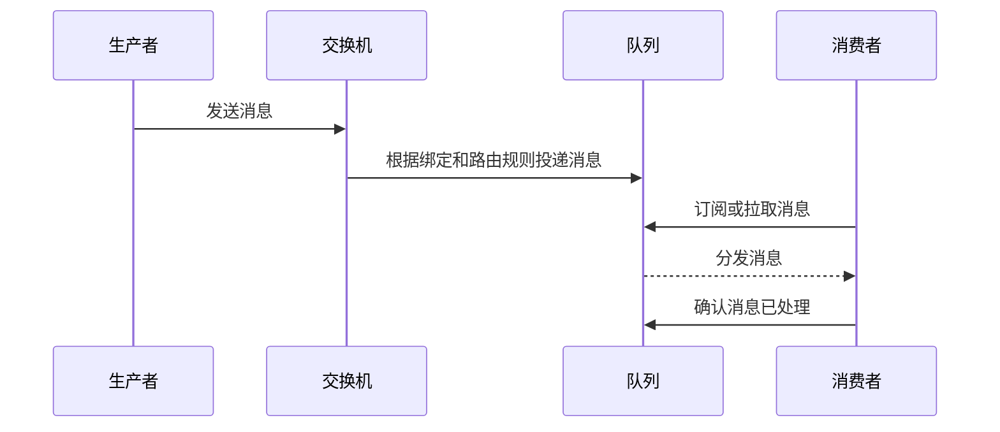

基本过程如下：

1. 生产者创建消息。
2. 生产者把消息发送到交换机。
3. 交换机根据绑定规则和路由键，把消息投递到队列。
4. 消费者从队列中获取消息。
5. 消费者处理完成后，向 RabbitMQ 确认消息。
6. RabbitMQ 收到确认后，从队列中删除该消息。

## 常见消息队列使用方式

### 1. 简单队列

一个生产者，一个队列，一个消费者。

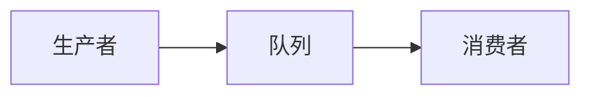

适合最基础的异步处理场景，例如发送邮件、生成日志、处理后台任务。

### 2. 工作队列

一个队列，多个消费者共同处理消息。

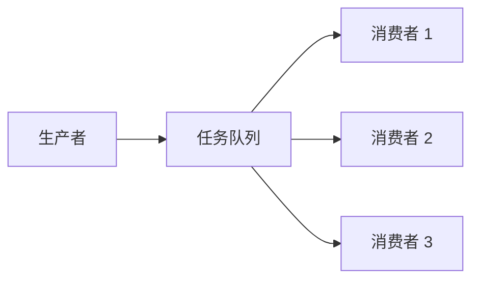

特点：

- 多个消费者分担任务，提高处理能力。
- 同一条消息通常只会被一个消费者处理。
- 可以配合手动确认和 `prefetch` 控制消费者一次拿多少消息。

适合耗时任务，例如图片处理、报表生成、订单后续处理。

### 3. 发布订阅

一条消息广播给多个队列，不同队列对应不同消费者。

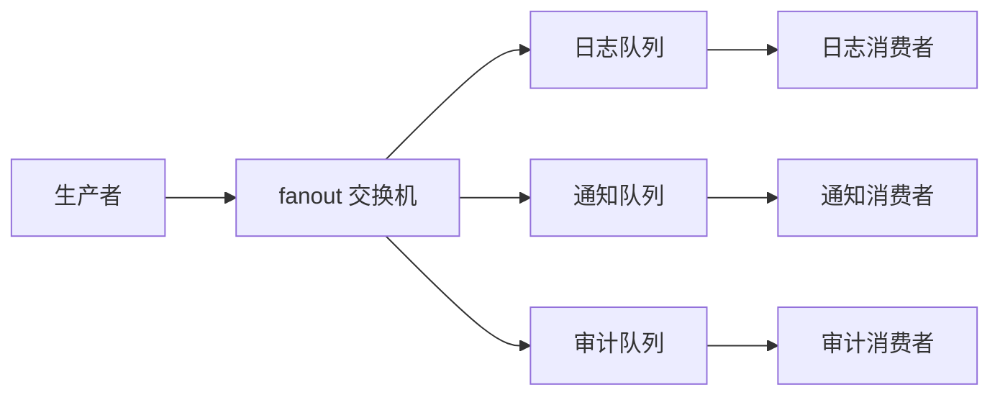

特点：

- 每个队列都会收到一份消息。
- 不同业务可以独立消费同一类事件。
- 新增消费者通常可以通过新增队列完成，不影响已有消费者。

适合事件广播，例如用户注册后同时触发欢迎邮件、积分初始化、审计记录。

### 4. 路由模式

生产者发送消息时带上 `routing_key`，交换机根据匹配规则把消息发送到指定队列。

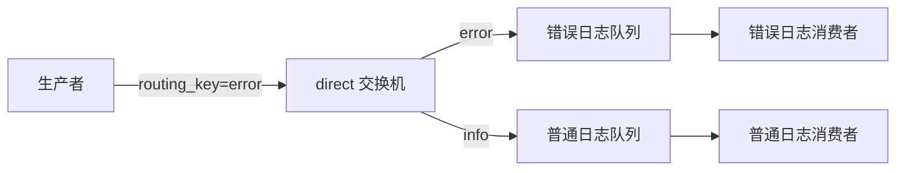

特点：

- 消息可以按类型进入不同队列。
- 消费者只处理自己关心的消息。

适合日志级别区分、订单状态区分、业务类型区分。

### 5. 主题模式

主题模式使用 `topic` 交换机，支持通配符匹配。

常见规则：

- `*` 匹配一个单词。
- `#` 匹配零个或多个单词。

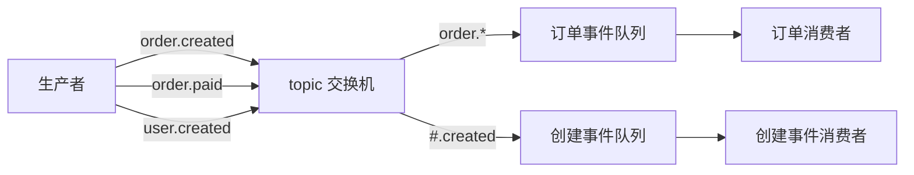

特点：

- 路由规则比 `direct` 更灵活。
- 适合事件名称有层级结构的场景。

例如：

- `order.created`
- `order.paid`
- `user.created`
- `user.deleted`

## 三种典型生产场景示例

下面用实际业务场景把生产者、`binding_key`、交换机、`routing_key`、队列和消费者串起来。

先记住一个关键点：生产者发送消息时带的是 `routing_key`，队列绑定交换机时带的是 `binding_key`。两者不是同一个字段，只是在某些交换机类型下需要互相匹配。

### 场景一：简单队列处理欢迎邮件

业务场景：用户注册成功后，系统需要异步发送欢迎邮件。

这个场景中只有一个生产者、一个队列、一个消费者。生产者不直接调用邮件服务，而是把“发送欢迎邮件”这件事变成消息放入队列。

实体关系：

- 生产者：用户服务，负责发送注册成功消息。
- Exchange：默认交换机，RabbitMQ 自带，类型可以理解为 `direct`。
- `routing_key`：`email.welcome.queue`。
- `binding_key`：默认交换机会自动把队列名作为绑定键。
- Queue：`email.welcome.queue`，保存待发送邮件任务。
- 消费者：邮件服务，负责真正发送邮件。

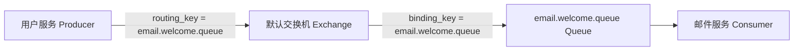

消息如何流转：

1. 用户注册成功。
2. 用户服务发送一条消息：`{"user_id": 1001, "email": "user@example.com"}`。
3. 消息发送到默认交换机，`routing_key` 是 `email.welcome.queue`。
4. 默认交换机根据队列名匹配，把消息投递到 `email.welcome.queue`。
5. 邮件服务消费者从队列取出消息并发送邮件。

这里的重点是：简单队列通常不需要自己声明复杂的交换机和绑定关系，使用默认交换机就可以完成“发到指定队列”的效果。

### 场景二：工作队列处理图片压缩任务

业务场景：用户上传图片后，系统需要压缩图片。图片压缩比较耗时，所以希望多个消费者一起处理。

这个场景中还是一个队列，但有多个消费者。每条消息只会交给其中一个消费者处理。

实体关系：

- 生产者：图片上传服务，负责发送图片压缩任务。
- Exchange：默认交换机，或者一个普通 `direct` 交换机。
- `routing_key`：`image.compress.queue`。
- `binding_key`：`image.compress.queue`。
- Queue：`image.compress.queue`，保存待压缩图片任务。
- 消费者：多个图片处理进程，共同消费同一个队列。

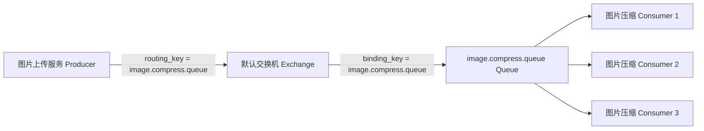

消息如何流转：

1. 用户上传一张图片。
2. 图片上传服务发送一条压缩任务消息。
3. 消息进入 `image.compress.queue`。
4. 三个消费者都监听这个队列。
5. RabbitMQ 把不同消息分发给不同消费者。
6. 某条具体消息只会被一个消费者处理，不会三个消费者都处理同一条消息。

这个模式的重点是：**扩展消费者数量就可以提高处理能力**。

实际生产中，工作队列通常会配合：

- 手动确认：任务处理完成后再确认消息。
- `prefetch`：限制每个消费者一次拿太多任务。
- 持久化队列和持久化消息：降低 RabbitMQ 重启时消息丢失的风险。

### 场景三：路由模式处理不同级别的日志

业务场景：系统会产生不同级别的日志，例如 `info`、`warning`、`error`。普通日志可以进入普通日志队列，错误日志需要进入告警队列。

这个场景中会显式使用 `direct` 交换机。生产者发送消息时带上不同的 `routing_key`，交换机根据队列的 `binding_key` 决定消息进入哪个队列。

实体关系：

- 生产者：业务服务，负责发送日志消息。
- Exchange：`log.direct.exchange`，类型是 `direct`。
- `routing_key`：日志级别，例如 `info`、`warning`、`error`。
- `binding_key`：队列绑定到交换机时声明的日志级别。
- Queue：普通日志队列、错误日志队列。
- 消费者：日志入库消费者、错误告警消费者。

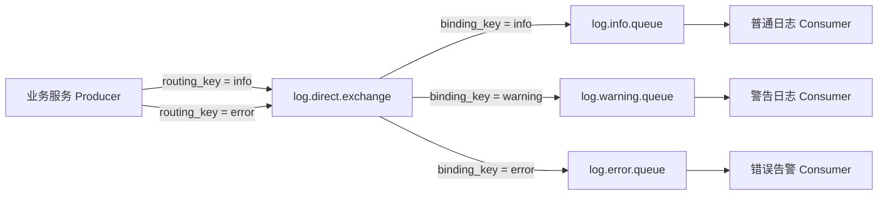

消息如何流转：

1. 业务服务产生一条 `error` 日志。
2. 生产者把消息发送到 `log.direct.exchange`。
3. 生产者设置 `routing_key = error`。
4. 交换机查找哪些队列的 `binding_key` 等于 `error`。
5. 消息进入 `log.error.queue`。
6. 错误告警消费者取出消息，发送告警通知。

如果生产者发送的是 `routing_key = info`，消息会进入 `log.info.queue`，不会进入 `log.error.queue`。

路由模式的重点是：**生产者通过 `routing_key` 表达消息类型，交换机通过 `binding_key` 找到匹配的队列**。

### 三种场景对比

| 场景 | Exchange | `routing_key` | `binding_key` | Queue | Consumer |
|---|---|---|---|---|---|
| 简单队列 | 默认交换机 | 通常等于队列名 | 默认等于队列名 | 一个队列 | 一个消费者 |
| 工作队列 | 默认交换机或 `direct` 交换机 | 通常等于任务队列名 | 通常等于任务队列名 | 一个任务队列 | 多个消费者竞争消费 |
| 路由模式 | `direct` 交换机 | 表示消息类型 | 表示队列接收哪类消息 | 多个队列 | 不同消费者处理不同类型消息 |

可以这样理解：

- 简单队列：一类消息交给一个消费者处理。
- 工作队列：一类消息交给多个消费者分担处理。
- 路由模式：多类消息按 `routing_key` 分发到不同队列，再由不同消费者处理。

## 几种消费方式

### 自动确认

消费者拿到消息后，RabbitMQ 立即认为消息已经处理完成。

优点是简单，缺点是如果消费者拿到消息后程序崩溃，消息可能丢失。

适合对可靠性要求不高的场景。

### 手动确认

消费者处理完消息后，主动发送确认。

如果消费者处理过程中异常退出，RabbitMQ 可以把未确认的消息重新放回队列，交给其他消费者处理。

这是实际业务中更常用的方式。

### 拒绝或重新入队

消费者处理失败时，可以拒绝消息。

常见选择：

- 重新入队：适合临时失败，例如网络抖动、下游服务短暂不可用。
- 不重新入队：适合消息本身有问题，例如格式错误、参数非法。

实际项目中通常会配合重试队列或死信队列处理失败消息。

### 预取限制

`prefetch` 用于限制消费者一次最多拿多少条未确认消息。

例如设置 `prefetch=1` 时，RabbitMQ 会等消费者确认当前消息后，再继续分发下一条消息。

这样可以避免某个消费者一次拿走太多消息，导致任务分配不均。

## 小结

RabbitMQ 的基本关系可以简单理解为：

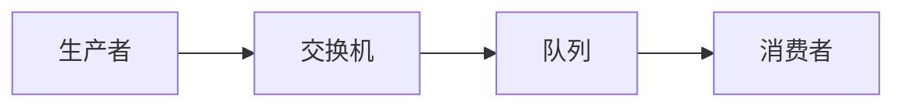

各实体职责：

- 生产者：负责发送消息。
- 交换机：负责根据规则分发消息。
- 队列：负责保存消息。
- 消费者：负责处理消息。
- 绑定：负责连接交换机和队列。
- 路由键：负责描述消息应该如何路由。

常见使用方式：

- 简单队列：一个生产者对应一个消费者。
- 工作队列：多个消费者分担同一个队列中的任务。
- 发布订阅：一条消息广播给多个业务队列。
- 路由模式：根据明确的路由键分发消息。
- 主题模式：根据通配符规则分发消息。
