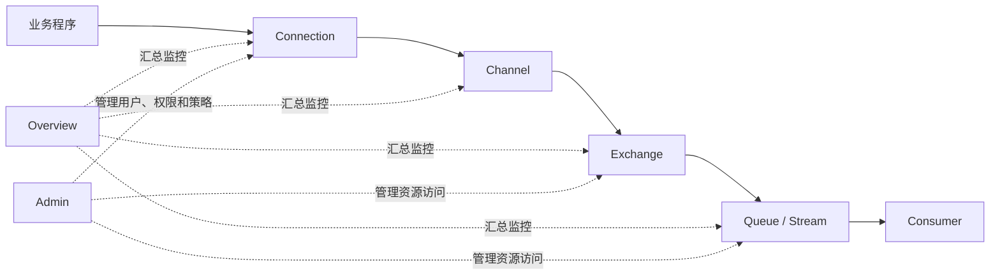

# RabbitMQ 管理控制台模块说明

RabbitMQ Management Plugin 提供浏览器管理界面和 HTTP API，可以查看 RabbitMQ 的运行状态、消息流量、客户端连接和资源配置，也可以执行部分管理操作。

Management 控制台的主要模块可以按照下面的消息链路理解：



简单来说：

| 模块 | 主要回答的问题 |
|---|---|
| Overview | RabbitMQ 整体是否健康？ |
| Connections | 哪些客户端连接到了 RabbitMQ？ |
| Channels | 每条连接正在进行哪些消息操作？ |
| Exchanges | 消息通过什么规则路由？ |
| Queues and Streams | 消息存在哪里、积压多少、由谁消费？ |
| Admin | 谁能访问、能做什么、系统策略是什么？ |

## 概览

Overview 是 RabbitMQ 节点或集群的总览页面，用于快速判断系统是否健康。

### 主要信息

- Connection、Channel、Exchange、Queue 和 Consumer 总数。
- 消息总数：
  - `Ready`：还在队列中等待投递的消息。
  - `Unacked`：已经投递给消费者，但还没有收到 ACK 的消息。
  - `Total`：`Ready + Unacked`。
- 消息速率：
  - Publish：生产者发布消息的速率。
  - Deliver/Get：RabbitMQ 投递或客户端主动拉取消息的速率。
  - Ack：消费者确认消息的速率。
- RabbitMQ 节点状态。
- 内存、磁盘、文件描述符和 Socket 使用情况。
- RabbitMQ、Erlang 版本和集群节点信息。

### 常见排障判断

| 现象 | 可能原因 |
|---|---|
| `Ready` 持续上涨 | 消费速度低于生产速度，或者没有消费者 |
| `Unacked` 持续上涨 | 消费者处理慢、未发送 ACK、prefetch 过大或消费者异常 |
| Publish 有速率，Deliver 为零 | 没有匹配的 Binding、Queue 不存在或没有消费者 |
| Publish 和 Deliver 都为零 | 生产者没有发送消息，或者连接到了错误的 vhost |
| 内存或磁盘出现告警 | RabbitMQ 可能阻塞生产者，需要检查积压和节点资源 |

Overview 适合观察整体趋势。需要定位到具体客户端或资源时，应继续进入 Connections、Channels、Exchanges 或 Queues 页面。

## 连接

Connections 页面显示客户端与 RabbitMQ 建立的网络连接。

Connection 通常是一条长期存在的 TCP 连接。Python 或 Go 服务启动后，会先创建 Connection，再在 Connection 中创建一个或多个 Channel。

### 可以查看的内容

- 客户端 IP 和端口。
- RabbitMQ 节点地址。
- 登录用户名。
- 连接的 vhost。
- 使用的协议和 TLS 信息。
- 心跳参数。
- 客户端名称、版本和客户端属性。
- Connection 中的 Channel 数量。
- 发送和接收的数据量。
- Connection 是否处于 blocked 或 blocking 状态。

### 主要用途

- 判断某个服务是否已经连接 RabbitMQ。
- 确认服务使用了哪个用户和 vhost。
- 查找连接来自哪个 IP 地址。
- 检查应用是否创建了过多 Connection。
- 判断生产者是否因为内存或磁盘告警而被 RabbitMQ 阻塞。

根据权限，管理员可以关闭指定 Connection。关闭 Connection 会同时关闭它下面的 Channel 和 Consumer，可能导致业务中断，生产环境需要谨慎操作。

## 通道

Channel 是复用在 Connection 上的逻辑通信通道。

```text
一个 Connection
├── Channel 1：发布消息
├── Channel 2：消费消息
└── Channel 3：执行其他 AMQP 操作
```

Connection 的创建成本比较高，应用通常会复用少量长期 Connection，并根据并发需求创建适量 Channel。

### 可以查看的内容

- Channel 属于哪个 Connection。
- Channel 使用的用户和 vhost。
- Consumer 数量。
- `prefetch` 设置。
- Unacked 消息数量。
- Publish、Deliver 和 Ack 速率。
- Publisher Confirm 状态。
- 尚未确认的发布消息数量。

### 主要用途

- 检查消费者为什么积压大量 Unacked 消息。
- 检查 `prefetch` 是否设置过大或过小。
- 确认某个 Channel 是用于发布还是消费。
- 判断一个 Connection 是否创建了过多 Channel。
- 检查 Publisher Confirm 是否启用。

不要为每一条消息创建新的 Connection 或 Channel。频繁创建和关闭连接会造成连接抖动并增加 RabbitMQ 资源消耗。

## 交换机

Exchanges 页面用于查看和管理当前 vhost 中的交换机。

Exchange 接收生产者发布的消息，再根据 Exchange 类型、`routing_key` 和 Binding 把消息路由到 Queue、Stream 或其他 Exchange。Exchange 本身通常不保存消息。

### 可以查看的内容

- Exchange 名称。
- Exchange 类型：`direct`、`topic`、`fanout`、`headers` 等。
- 是否 `durable`。
- 是否 `auto_delete`。
- 是否为 `internal`。
- Publish 和路由速率。
- Exchange 与 Queue 或其他 Exchange 的 Binding。
- Exchange arguments 和应用的 Policy。

### 根据权限可以执行的操作

- 创建或删除 Exchange。
- 添加或删除 Binding。
- 手动向 Exchange 发布测试消息。

### 主要用途

- 确认生产者使用的 Exchange 是否存在。
- 检查 Exchange 类型是否正确。
- 检查 `routing_key` 是否能够匹配 Binding 的 `binding_key`。
- 排查生产者发布成功但 Queue 没有消息的问题。
- 查看一个 Exchange 将消息路由到了哪些 Queue。

以 `amq.` 开头的 Exchange 通常是 RabbitMQ 预声明或系统使用的 Exchange，不建议随意删除。默认 Exchange 的名称在 AMQP 客户端中是空字符串，在权限检查中通常表示为 `amq.default`。

## 队列与流

这个页面同时显示普通 Queue 和 Stream，两者的存储和消费语义不同。

### 队列

Queue 保存等待消费者处理的消息。普通消息在消费者成功 ACK 后会从 Queue 中删除。

#### 可以查看的内容

- Queue 名称和所在 vhost。
- Queue 类型：`classic` 或 `quorum`。
- Queue 运行状态。
- `Ready`、`Unacked` 和总消息数。
- Consumer 数量。
- Publish、Deliver、Get 和 Ack 速率。
- 内存、磁盘和消息字节数。
- 是否 `durable`、`exclusive`、`auto_delete`。
- Queue arguments、Policy 和 Operator Policy。
- Binding 和 Consumer 详情。

#### 根据权限可以执行的操作

- 创建或删除 Queue。
- Purge 清空 Queue。
- 添加或删除 Binding。
- 使用 `Get messages` 获取 Queue 中的消息。

`Get messages` 属于实际消费操作，不是完全无副作用的消息预览。所选 ACK 模式可能让消息重新入队，也可能确认并删除消息。`Purge` 会直接清空 Queue，`Delete` 会删除 Queue 及其中的消息，生产环境操作前必须确认目标资源。

### 流

Stream 是持久化的追加日志。消息不会因为某个消费者读取或确认就立即删除，而是根据保留时间、最大容量等规则清理。

Stream 的典型特点：

- 支持消费者根据 offset 读取消息。
- 可以重新读取历史消息。
- 不同消费者可以维护各自的消费位置。
- 适合高吞吐、大量积压和消息回放场景。

常见用途包括日志、审计事件、用户行为数据和事件流。

可以这样理解两者的区别：

```text
Queue：一项任务等待某个消费者处理，ACK 后通常删除。
Stream：一条事件写入日志，可由不同消费者在保留期内反复读取。
```

## 管理

Admin 页面用于管理用户、vhost、权限、Policy 和其他 RabbitMQ 配置。能够看到和操作哪些内容取决于当前用户的标签与资源权限。

### 常见管理内容

- Users：创建、删除用户，修改密码和用户标签。
- Virtual Hosts：创建和删除 vhost。
- Permissions：配置用户在不同 vhost 中的 `configure`、`write`、`read` 权限。
- Policies：为匹配的 Queue、Stream 或 Exchange 设置策略。
- Operator Policies：由运维人员设置强制性保护策略。
- Limits：配置 vhost 或用户的连接数、Queue 数等资源限制。
- Runtime Parameters：管理 Federation、Shovel 等功能使用的运行参数。
- Feature Flags：查看和管理版本功能开关。

### 用户标签

| 标签 | 主要能力 |
|---|---|
| `management` | 登录管理后台，查看自己有权限访问的 vhost 和资源 |
| `policymaker` | 在有权限的 vhost 中管理 Policy 和参数 |
| `monitoring` | 查看节点信息、全局统计以及其他用户的 Connection 和 Channel |
| `administrator` | 管理用户、vhost 和权限等管理内容 |

用户标签和资源权限是两套机制：

- 用户标签主要控制 Management UI 和 HTTP API 中的管理能力。
- `configure`、`write`、`read` 决定用户能否操作具体的 Exchange 和 Queue。

即使用户具有 `administrator` 标签，也仍然要根据它在相应 vhost 中的资源权限判断是否能够发布、消费或修改资源。

## 常用排障路径

### 服务无法连接 RabbitMQ

1. 在 Connections 中确认是否出现连接。
2. 检查连接使用的用户名和 vhost。
3. 在 Admin 中检查用户是否拥有该 vhost 的权限。
4. 查看 RabbitMQ 日志中的认证、TLS 或网络错误。

### 生产者发送成功，但队列没有消息

1. 在 Connections 和 Channels 中确认生产者已经连接并持续 Publish。
2. 在 Exchanges 中确认目标 Exchange 存在且类型正确。
3. 检查发布消息的 `routing_key`。
4. 检查 Exchange 到 Queue 的 Binding 和 `binding_key`。
5. 检查是否存在无法路由的消息，并考虑使用 `mandatory` 或 alternate exchange。

### 队列消息持续积压

1. 在 Queues 中判断积压的是 Ready 还是 Unacked。
2. 检查 Consumer 数量是否为零。
3. 在 Channels 中检查消费者的 `prefetch`、Unacked 和 Ack 速率。
4. 在 Connections 中确认消费者连接是否频繁断开。
5. 检查消费者日志和业务处理耗时。

### 管理后台看不到某些虚拟主机或资源

1. 在 Admin 中检查当前用户标签。
2. 检查用户是否拥有目标 vhost 的任意资源权限。
3. 区分管理标签和 `configure/write/read` 资源权限。
4. 权限修改后，让客户端重新连接再验证。

## 使用注意事项

- Management UI 适合开发调试、日常检查和短期趋势观察。
- 生产环境的长期监控建议接入 Prometheus、Grafana 等外部监控系统。
- 不要在生产环境随意执行 Close Connection、Purge Queue、Delete Queue 或 Delete Exchange。
- 使用 `Get messages` 前应确认 ACK 模式，避免误删消息。
- 应用程序不要使用管理员账号，应为每个应用创建独立的最小权限账号。
- 页面中显示的 vhost 和资源范围会受当前用户标签与权限影响。

## 官方资料

- [Management Plugin](https://www.rabbitmq.com/docs/management)
- [Monitoring](https://www.rabbitmq.com/docs/monitoring)
- [Authentication and Authorisation](https://www.rabbitmq.com/docs/access-control)
- [Exchanges](https://www.rabbitmq.com/docs/exchanges)
- [Queues](https://www.rabbitmq.com/docs/queues)
- [Streams](https://www.rabbitmq.com/docs/streams)
