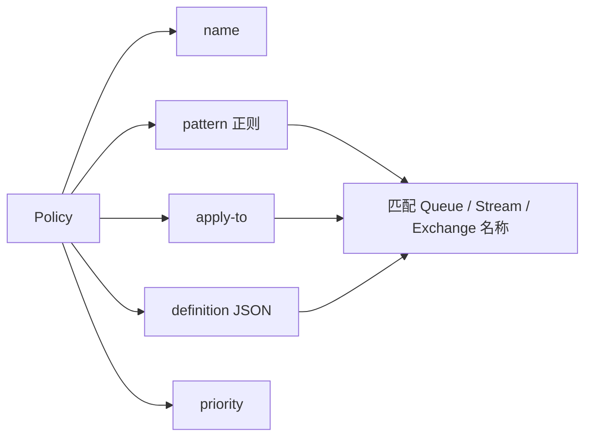

# RabbitMQ 消息与资源策略

本文介绍 RabbitMQ 普通 Policy、Operator Policy、常用消息处理策略、优先级和配置覆盖关系。内容以 RabbitMQ 4.3 为基础。

Policy 作用于指定 vhost 中的 Queue、Stream 和 Exchange，不用于给用户授予 `configure`、`write`、`read` 权限。用户授权参见 [RabbitMQ 用户与权限控制](./rabbitmq-user-permissions.md)。

## 策略解决什么问题

Queue 和 Exchange 的很多可选行为可以在应用声明资源时通过 `x-arguments` 指定，例如 TTL、DLX 和长度限制。但把这些参数硬编码到 Python 或 Go 程序中会产生以下问题：

- 修改参数需要变更和重新部署应用。
- 不同语言或服务可能声明出不一致的参数。
- 部分参数变化可能要求删除并重新声明资源。
- 运维人员难以给一组资源统一施加保护上限。

Policy 使用正则匹配一组资源，并动态注入或更新可配置参数，因此更适合管理 TTL、DLX、长度限制、Stream 保留时间和 Federation 等行为。



## 策略的组成

| 字段 | 含义 |
|---|---|
| `name` | Policy 名称，在一个 vhost 中唯一 |
| `pattern` | 匹配 Queue、Stream 或 Exchange 名称的正则表达式 |
| `apply-to` | 限定 Policy 应用于哪类资源 |
| `definition` | 具体配置，使用 JSON 对象表示 |
| `priority` | 多个 Policy 匹配时的选择优先级，数值越大优先级越高 |

Policy 属于一个具体 vhost，只会匹配该 vhost 中的资源。

### `apply-to` 可选值

| 值 | 作用范围 |
|---|---|
| `exchanges` | 只匹配 Exchange |
| `queues` | 匹配所有 Queue 类型，包括 Stream |
| `classic_queues` | 只匹配 Classic Queue |
| `quorum_queues` | 只匹配 Quorum Queue |
| `streams` | 只匹配 Stream |
| `all` | 匹配所有 Exchange、Queue 和 Stream |

默认 `apply-to` 是 `all`，默认优先级是 `0`。生产配置建议明确写出 `apply-to`，避免策略作用到意外的资源类型。

## 普通策略与运算符策略

### 普通策略

普通 Policy 用于配置业务资源行为，例如：

- 消息 TTL。
- Queue 过期时间。
- Queue 长度限制。
- DLX。
- Alternate Exchange。
- Stream 数据保留。
- Federation。

拥有相应管理权限的业务或平台人员可以维护普通 Policy。

### 运算符策略

Operator Policy 由 RabbitMQ 运维人员设置，用于给应用施加强制保护边界，例如：

- Queue 最大消息数量。
- Queue 最大字节数。
- 消息最大 TTL。
- Quorum Queue 的交付次数上限。
- 防止应用创建无限增长的 Queue 或 Stream。

普通 Policy 与 Operator Policy 可以同时影响一个资源。Operator Policy 不是简单地无条件覆盖普通 Policy；对于长度、TTL 等数值限制，RabbitMQ 通常采用更保守、更严格的值。

## 常见策略定义

### 队列和消息生命周期

| definition key | 值 | 作用 |
|---|---|---|
| `message-ttl` | 毫秒整数 | 消息在 Queue 中允许保留的最长时间 |
| `expires` | 毫秒整数 | Queue 长时间未被使用后自动删除 |
| `max-length` | 整数 | Queue 最多保留的 Ready 消息数量 |
| `max-length-bytes` | 字节整数 | Queue 或 Stream 最大数据容量 |
| `overflow` | `drop-head` 或 `reject-publish` | Queue 超过长度限制时的处理方式 |

`message-ttl` 到期后，消息会被丢弃；如果 Queue 配置了 DLX，则会尝试进行死信处理。

`expires` 删除的是整个长期未使用的 Queue。Queue 过期删除时，其中的消息不会因为 Queue 过期这一事件而逐条进入 DLX。

`overflow` 常见值：

- `drop-head`：删除 Queue 头部较旧的消息，为新消息腾出空间。
- `reject-publish`：拒绝导致 Queue 超限的新发布，并在 Publisher Confirm 中反馈拒绝。

### 死信交换机

| definition key | 值 | 作用 |
|---|---|---|
| `dead-letter-exchange` | Exchange 名称 | 指定死信消息重新发布到哪个 Exchange |
| `dead-letter-routing-key` | routing key | 覆盖死信消息使用的 routing key |

消息通常在以下情况下进入死信流程：

- 消费者 Reject 或 Nack，并设置 `requeue=false`。
- 消息 TTL 到期。
- Queue 超过长度限制并丢弃消息。
- Quorum Queue 中消息的重复交付次数超过 `delivery-limit`。

DLX 是普通 Exchange，必须提前存在并配置到目标 Queue 的 Binding。配置了 `dead-letter-exchange` 并不代表已经自动创建 DLX 或死信 Queue。

### 仲裁队列

| definition key | 值 | 作用 |
|---|---|---|
| `delivery-limit` | 整数 | 限制消息被重新投递的次数 |
| `dead-letter-strategy` | `at-most-once` 或 `at-least-once` | 控制 Quorum Queue 的死信转发保障方式 |

从 RabbitMQ 4.0 开始，Quorum Queue 默认 `delivery-limit` 为 `20`。超过限制后，消息会被丢弃；如果配置了 DLX，则会进行死信处理。

将 `delivery-limit` 设置为 `-1` 可以禁用限制，但可能让重复 Nack/Requeue 的毒消息无限循环，生产环境通常不建议这样做。

Quorum Queue 使用 `at-least-once` 死信策略时，还需要：

- `dead-letter-strategy` 为 `at-least-once`。
- `overflow` 为 `reject-publish`。
- 配置 `dead-letter-exchange`。

这种方式可靠性更高，但会消耗更多资源，并且在目标 Queue 不可用时可能让死信继续占用源 Queue 容量。

### 备用交换机

| definition key | 值 | 作用 |
|---|---|---|
| `alternate-exchange` | Exchange 名称 | 原 Exchange 无法路由消息时，将消息交给备用 Exchange |

Alternate Exchange 应用于 Exchange，而 DLX 应用于 Queue：

```text
消息在 Exchange 阶段无法路由 → Alternate Exchange
消息进入 Queue 后过期、拒绝或超限 → Dead Letter Exchange
```

### 流保留策略

| definition key | 值 | 作用 |
|---|---|---|
| `max-age` | 例如 `7D`、`12h`、`30m` | 按时间保留 Stream 数据 |
| `max-length-bytes` | 字节整数 | 按总容量限制 Stream 数据 |

Stream 是追加日志，达到保留条件后按数据段删除较旧数据。`max-age` 和 `max-length-bytes` 可以同时使用。

### 联邦

启用 Federation 插件后，常见配置包括：

| definition key | 作用 |
|---|---|
| `federation-upstream` | 指定一个 Federation Upstream |
| `federation-upstream-set` | 指定一个 Upstream 集合 |

Federation Policy 应只匹配需要跨集群同步的 Queue 或 Exchange，避免使用过宽的 `.*` 意外联邦所有业务资源。

## 创建和管理普通策略

以下示例使用 `commerce-prod` vhost。

### 查看策略

```bash
rabbitmqctl list_policies -p commerce-prod
```

使用表格格式查看关键字段：

```bash
rabbitmqctl list_policies -p commerce-prod \
  --formatter=pretty_table
```

### 消息生存时间

所有以 `temp.` 开头的 Queue 中，消息最多保留 60 秒：

```bash
rabbitmqctl set_policy -p commerce-prod temp-message-ttl \
  '^temp\.' \
  '{"message-ttl":60000}' \
  --apply-to queues \
  --priority 10
```

### 队列过期

以 `temporary.` 开头的 Queue，连续 30 分钟未使用后自动删除：

```bash
rabbitmqctl set_policy -p commerce-prod temporary-queue-expiry \
  '^temporary\.' \
  '{"expires":1800000}' \
  --apply-to queues \
  --priority 10
```

### 队列长度和超限处理

订单 Queue 最多保留 10 万条 Ready 消息，超限时拒绝新消息：

```bash
rabbitmqctl set_policy -p commerce-prod order-queue-limit \
  '^order\.' \
  '{"max-length":100000,"overflow":"reject-publish"}' \
  --apply-to queues \
  --priority 10
```

### 死信交换机

```bash
rabbitmqctl set_policy -p commerce-prod order-dlx \
  '^order\.' \
  '{"dead-letter-exchange":"orders.dlx","dead-letter-routing-key":"order.dead"}' \
  --apply-to queues \
  --priority 10
```

### 合并消息生存时间、长度限制和死信交换机

同一个资源在任意时刻最多应用一个普通 Policy。如果同一组 `order.` Queue 同时需要 TTL、长度限制和 DLX，应把这些 key 合并到一个 definition 中：

```bash
rabbitmqctl set_policy -p commerce-prod order-safety \
  '^order\.' \
  '{"message-ttl":86400000,"max-length":100000,"overflow":"reject-publish","dead-letter-exchange":"orders.dlx","dead-letter-routing-key":"order.dead"}' \
  --apply-to queues \
  --priority 20
```

### 仲裁队列重复投递限制

```bash
rabbitmqctl set_policy -p commerce-prod quorum-delivery-limit \
  '^order\.' \
  '{"delivery-limit":20,"dead-letter-exchange":"orders.dlx"}' \
  --apply-to quorum_queues \
  --priority 30
```

### 备用交换机

```bash
rabbitmqctl set_policy -p commerce-prod orders-alternate-exchange \
  '^orders\.direct$' \
  '{"alternate-exchange":"unrouted.fanout"}' \
  --apply-to exchanges \
  --priority 10
```

### 流保留七天或最多 100 GiB

```bash
rabbitmqctl set_policy -p commerce-prod event-stream-retention \
  '^events\.' \
  '{"max-age":"7D","max-length-bytes":107374182400}' \
  --apply-to streams \
  --priority 10
```

### 更新策略

使用相同 vhost 和相同 Policy 名称重新执行 `set_policy`，会更新已有 Policy：

```bash
rabbitmqctl set_policy -p commerce-prod temp-message-ttl \
  '^temp\.' \
  '{"message-ttl":120000}' \
  --apply-to queues \
  --priority 10
```

### 删除策略

```bash
rabbitmqctl clear_policy -p commerce-prod temp-message-ttl
```

## 创建和管理运算符策略

例如，强制所有 Queue 最多使用 1 GiB 消息容量：

```bash
rabbitmqctl set_operator_policy -p commerce-prod queue-size-guardrail \
  '.*' \
  '{"max-length-bytes":1073741824}' \
  --apply-to queues \
  --priority 100
```

查看 Operator Policy：

```bash
rabbitmqctl list_operator_policies -p commerce-prod
```

删除 Operator Policy：

```bash
rabbitmqctl clear_operator_policy -p commerce-prod queue-size-guardrail
```

Operator Policy 适合做资源保护，不适合承载全部业务语义。DLX 名称、业务 TTL 等通常放在普通 Policy；平台强制的最大容量等放在 Operator Policy。

## 策略匹配与优先级

### 同时匹配多个普通策略

同一个资源最多应用一个普通 Policy：

- 优先级最高的 Policy 生效。
- 如果多个 Policy 优先级相同，选择结果不确定，应避免这种配置。
- 如果资源同时需要多个配置，应把 definition key 合并进同一个 Policy。

例如下面两个 Policy 都匹配 `order.created.q`：

```text
^order\.      priority=10
^order\.created\.q$  priority=20
```

优先级为 `20` 的 Policy 生效，但不会自动与优先级为 `10` 的 definition 合并。

### 应用 `x-arguments`、普通策略和运算符策略

一般规则：

1. 应用声明资源时提供的 `x-arguments` 通常优先于普通 Policy。
2. Operator Policy 与普通 Policy 合并，用作平台保护边界。
3. 对 TTL、长度等数值限制，通常使用更保守的值。
4. Stream 配置以及 Quorum Queue 的 `overflow` 存在特殊优先级规则，Policy 可以优先于应用参数。

为了减少认知成本，生产环境应避免在应用、普通 Policy 和 Operator Policy 中重复配置同一个业务 key：

- 应用只声明不能动态改变的属性。
- 普通 Policy 管理业务可变行为。
- Operator Policy 只设置平台保护上限。

## 不能通过策略设置的属性

Policy 适合动态配置，不适合修改创建后不可变的资源属性。

以下内容不能通过普通 Policy 改变：

- Queue 类型：`classic`、`quorum`、`stream`。
- Exchange 类型：`direct`、`topic`、`fanout`、`headers`。
- Queue 的 `durable`、`exclusive`、`auto_delete`。
- Exchange 的 `durable`、`auto_delete`、`internal`。
- Classic Queue 的最大优先级 `x-max-priority`。

这些属性应由 definitions、部署任务或客户端声明时确定。同名资源已经存在但重新声明属性不一致，通常会导致 `406 PRECONDITION_FAILED`。

## RabbitMQ 4.x 版本注意事项

RabbitMQ 4.x 已移除 Classic Mirrored Queues。旧教程中的以下 Policy key 已不再适用：

```text
ha-mode
ha-params
ha-sync-mode
ha-sync-batch-size
ha-promote-on-shutdown
ha-promote-on-failure
```

需要多副本和高可用 Queue 时，应使用 Quorum Queue，而不是继续配置 Classic Queue 镜像 Policy。

Quorum Queue 类型必须在 Queue 创建时确定，不能通过 Policy 把已经存在的 Classic Queue 转换为 Quorum Queue。

## 查看资源实际应用的策略

查看 Queue 使用的普通 Policy、Operator Policy 和最终 definition：

```bash
rabbitmqctl list_queues -p commerce-prod \
  name type policy operator_policy effective_policy_definition arguments
```

查看 Exchange：

```bash
rabbitmqctl list_exchanges -p commerce-prod \
  name type policy arguments
```

也可以在 Management UI 中打开具体 Queue 或 Exchange，检查 `Policy`、`Operator policy` 和 Arguments。

## 生产落地建议

- Policy 必须显式指定 vhost 和 `apply-to`。
- `pattern` 使用首尾锚点或清晰的业务前缀，避免误匹配。
- 同一类资源的 TTL、长度限制和 DLX 尽量合并到一个普通 Policy。
- 为所有重要 Quorum Queue 配置 DLX，避免毒消息超过 `delivery-limit` 后直接丢弃。
- 使用 Queue 或 Stream 容量限制，避免单个业务耗尽磁盘。
- DLX、Alternate Exchange 和对应 Binding 必须提前创建并验证。
- 生产者使用 Publisher Confirm；`overflow=reject-publish` 时必须处理发布拒绝。
- Policy 和 Operator Policy 应进入 definitions 或基础设施代码，并通过 CI/CD 发布。
- 修改 Policy 后检查目标资源的 effective policy 和关键指标。
- 升级到 RabbitMQ 4.x 前清理旧的 Classic Queue 镜像 Policy key。

## 官方资料

- [Policies](https://www.rabbitmq.com/docs/policies)
- [Time-To-Live and Expiration](https://www.rabbitmq.com/docs/ttl)
- [Queue Length Limits](https://www.rabbitmq.com/docs/maxlength)
- [Dead Letter Exchanges](https://www.rabbitmq.com/docs/dlx)
- [Alternate Exchanges](https://www.rabbitmq.com/docs/ae)
- [Quorum Queues](https://www.rabbitmq.com/docs/quorum-queues)
- [Streams](https://www.rabbitmq.com/docs/streams)
- [Federation](https://www.rabbitmq.com/docs/federation)
- [Production Deployment Guidelines](https://www.rabbitmq.com/docs/production-checklist)
