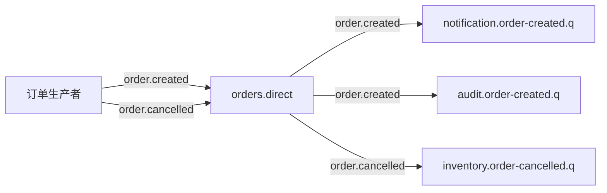

# 多团队共用 RabbitMQ 的生产实践问答

本文讨论一个 Python 团队和一个 Go 团队共同使用同一套 RabbitMQ 服务时，如何划分 vhost、exchange、queue、用户和权限，以及应该由谁创建拓扑。

适用场景：AMQP 0-9-1、长期运行的生产系统。文中的团队划分建议与编程语言无关。

## 先给结论

| 问题 | 建议 |
|---|---|
| Python 组和 Go 组是否共用 vhost | 不按语言划分。属于同一业务系统和同一环境时可以共用；不同业务、租户、安全边界或环境建议分开。 |
| 多个业务是否共用一个 direct exchange | 技术上可以，但不建议所有无关业务共用一个全局交换机。通常按业务域或消息契约建立交换机。 |
| 是否只用不同 routing key 区分队列 | 可以完成路由，但 routing key 不是安全隔离边界。direct exchange 只做完全匹配。 |
| 应用使用 admin 账号还是新账号 | 新建应用账号，通常每个可独立部署的应用一个账号；不要把管理员账号配置到业务程序中。 |
| 应用账号拥有哪些权限 | 按用途授予 `configure`、`write`、`read`，并通过资源名称正则限制范围；普通应用一般不设置管理标签。 |
| exchange、queue、binding 在哪里创建 | 推荐“部署期定义 + 程序启动声明”的混合方式；不要把人工终端操作作为生产环境唯一的配置来源。 |

## 问题一：Python 组和 Go 组正常情况下会共用同一个 vhost 吗？

会不会共用，取决于业务和隔离边界，而不是编程语言。

RabbitMQ 的 vhost 是逻辑隔离单元。连接、exchange、queue、binding、权限和 policy 都归属于某个 vhost。连接进入一个 vhost 后，只能操作该 vhost 内的资源。vhost 提供逻辑隔离，但不提供 CPU、内存、磁盘和网络层面的物理隔离。

常见判断方式如下：

| 情况 | vhost 建议 |
|---|---|
| Python 和 Go 服务共同组成同一个业务系统 | 可以共用，例如 `commerce-prod` |
| 两个团队负责互不相关的业务系统 | 建议分开，例如 `orders-prod`、`risk-prod` |
| 同一项目的开发、测试和生产环境 | 必须至少分 vhost，例如 `commerce-dev`、`commerce-test`、`commerce-prod` |
| 不同租户、不同合规边界或需要独立授权 | 建议分 vhost；隔离要求很高时进一步拆 RabbitMQ 集群 |
| 某个业务可能大量堆积消息并影响其他业务 | vhost 只能辅助设置权限和资源上限，真正的故障域隔离应考虑独立集群 |

因此，“Python 组一个 vhost、Go 组一个 vhost”通常不是好的默认规则。更合理的规则是：

```text
业务/租户 + 环境 = vhost 边界
可独立部署的应用 = 用户边界
业务域/消息契约 = exchange 边界
消费目的 = queue 边界
```

例如，Python 的通知服务和 Go 的订单服务都属于电商生产系统，可以共同连接 `commerce-prod`，但应使用不同用户和不同队列。

## 问题二：多个业务使用直连交换机时，是否共用一个交换机，再通过路由键路由到不同队列即可？

技术上完全可行。direct exchange 会把消息的 `routing_key` 与 binding 的 `binding_key` 做完全匹配。

例如：



这里会产生以下结果：

- `routing_key=order.created` 会分别向 Q1 和 Q2 投递一份消息。
- `routing_key=order.cancelled` 只会投递到 Q3。
- 多个消费者监听同一个队列时，它们竞争消费，一条消息通常只由其中一个消费者处理。
- 多个队列使用同一个 binding key 时，每个队列都会收到一份消息，属于发布订阅效果。
- 如果没有任何 binding 匹配，消息默认不会进入队列。需要关注无法路由的消息时，可使用 `mandatory`、publisher return 或 alternate exchange。

### 为什么不建议所有业务共用一个全局直连交换机？

因为 exchange 的复用会形成业务耦合：

- 不同团队需要共同维护 routing key 命名，容易冲突。
- 变更、排障、监控和责任归属会混在一起。
- RabbitMQ 的普通资源权限主要匹配 vhost 内的 exchange 和 queue 名称。对于 direct exchange，routing key 本身不能作为常规权限隔离边界。
- 某个生产者只要拥有该 exchange 的 `write` 权限，就可以向它发送任意 routing key。

因此推荐按业务域或消息契约划分，而不是为了减少 exchange 数量而强行复用：

```text
orders.direct
payments.direct
inventory.direct
```

同一业务域内的相关消息可以共用一个 exchange，例如 `orders.direct` 下使用：

```text
order.created
order.paid
order.cancelled
```

如果希望用 `order.*`、`*.created` 这样的通配符订阅，应使用 `topic` exchange；direct exchange 只支持完全相等，不支持通配符。

exchange 本身相对轻量，没有必要为了“少创建几个 exchange”而让无关业务共享一个全局交换机。

## 问题三：服务端程序连接 RabbitMQ 时，应该使用管理员账号还是新建用户？

生产环境应新建应用用户，不应把管理员账号配置到 Python 或 Go 业务程序中。

推荐每个可独立部署的应用使用独立账号，例如：

```text
orders_api_pub
notification_worker
inventory_worker
```

不要只建立 `python_team` 和 `go_team` 两个大账号。按应用建账号有以下好处：

- 可以准确识别连接来自哪个服务。
- 可以分别限制每个服务能够访问的资源。
- 某个凭据泄漏时只影响一个应用。
- 可以独立轮换密码，而不要求整个语言团队同时重启服务。

同一个应用的多个副本通常可以共享一个应用账号。安全要求更高时，可以继续细分为每个实例一个凭据，或者使用 x.509 证书、OAuth 2 等认证方式。

### 管理员账号应该做什么？

管理员账号只用于运维人员、自动化运维平台或受控的部署流水线，例如：

- 创建和删除 vhost、用户及权限。
- 设置 policy、limit 和运行参数。
- 查看全局监控数据。
- 导入 definitions。

RabbitMQ 的用户名是否叫 `admin` 并不决定权限。真正决定管理后台能力的是用户标签，例如 `administrator`；资源操作仍然受该用户在各 vhost 上的 `configure`、`write`、`read` 权限控制。普通业务应用通常不需要任何用户标签。

## 问题四：RabbitMQ 的配置、写入、读取权限分别表示什么？

这三类权限是按 vhost 设置的，值是匹配资源名称的正则表达式。

| 权限 | 典型用途 |
|---|---|
| `configure` | 声明、删除或修改 exchange、queue 等资源 |
| `write` | 向 exchange 发布消息；创建 queue binding 时还需要对目标 queue 的 `write` 权限 |
| `read` | 从 queue 消费或拉取消息；创建 queue binding 时还需要对源 exchange 的 `read` 权限 |

用户标签和上述资源权限是两套概念：

- `administrator`、`monitoring`、`management` 等标签主要控制管理 UI 和 HTTP API 的可见能力。
- `configure`、`write`、`read` 控制应用能否操作具体的 exchange 和 queue。

### 拓扑由部署系统提前创建时

发布者只向 `orders.direct` 发布消息，可以不给 `configure` 和 `read`：

```bash
rabbitmqctl set_permissions -p commerce-prod orders_api_pub \
  '^$' \
  '^orders\.direct$' \
  '^$'
```

消费者只读取 `notification.order-created.q`，可以不给 `configure` 和 `write`：

```bash
rabbitmqctl set_permissions -p commerce-prod notification_worker \
  '^$' \
  '^$' \
  '^notification\.order-created\.q$'
```

`^$` 只匹配空字符串，在这里相当于不允许操作普通命名资源。

### 消费者需要在启动时创建自己的队列和绑定关系时

假设 `orders.direct` 已经存在，消费者启动时负责声明自己的队列并建立绑定，可设置：

```bash
rabbitmqctl set_permissions -p commerce-prod notification_worker \
  '^notification\.order-created\.q$' \
  '^notification\.order-created\.q$' \
  '^(orders\.direct|notification\.order-created\.q)$'
```

原因是：

- 声明 queue 需要对 queue 的 `configure` 权限。
- `queue.bind` 需要对目标 queue 的 `write` 权限。
- `queue.bind` 需要对源 exchange 的 `read` 权限。
- 消费消息需要对 queue 的 `read` 权限。

如果该消费者还会使用非 passive 的方式声明 `orders.direct`，那么它的 `configure` 正则也要包含 `orders.direct`。生产环境不要简单地给所有应用 `.* / .* / .*`，应限制到应用拥有的资源名称。

## 问题五：交换机、队列和绑定关系应通过终端提前创建，还是由程序启动时创建？

两种方式 RabbitMQ 都支持。生产环境推荐混合使用，但所有固定拓扑都应进入版本控制和自动化流程。

### 建议由部署或运维系统创建的内容

- vhost、用户、权限和用户标签。
- policy、operator policy、资源限制。
- 多团队共享的 durable exchange。
- 由多个应用共同依赖、需要严格审核的 durable queue 和 binding。
- 死信交换机、死信队列等公共基础设施。

这些内容适合写进 definitions JSON、基础设施代码或部署脚本，在 RabbitMQ 启动或应用发布时自动导入。RabbitMQ 官方生产指南推荐在部署期通过 definition import 预置 vhost、用户、权限和拓扑。

### 建议由应用创建的内容

- 消费者自己拥有的 queue 和 binding。
- exclusive、auto-delete、服务端自动命名的临时队列。
- 生命周期明确归属于某个应用实例的动态资源。

固定资源也可以由应用在启动时声明。AMQP 的 declare 操作具有“没有则创建，参数相同则继续”的效果，因此很适合启动检查和连接恢复。

但必须保证 Python 和 Go 代码中的声明参数完全一致，包括：

- exchange 的名称、类型、`durable`、`auto_delete` 和 arguments。
- queue 的名称、类型、`durable`、`exclusive`、`auto_delete` 和 arguments。

同名资源已存在但声明属性不同，会导致 channel 级 `406 PRECONDITION_FAILED`。因此，共享资源的定义应只有一个明确的所有者和一份权威配置。

### 终端命令应该扮演什么角色？

- `rabbitmqctl`：主要管理节点、vhost、用户和权限，并查看运行状态；不是声明业务 exchange、queue、binding 的首选工具。
- `rabbitmqadmin`：通过管理 HTTP API 声明或删除 exchange、queue、binding，也可导入 definitions。
- RabbitMQ 管理后台：适合开发调试、临时检查和应急操作。
- 客户端程序：通过 Python 或 Go 客户端库声明应用拥有的拓扑。

人工在终端或管理后台点出来的生产拓扑容易发生配置漂移，也难以审计和重复部署，因此不应成为唯一来源。

## 问题六：为什么进入 RabbitMQ 容器后，使用 `rabbitmqctl` 或 `rabbitmqadmin` 没有提示登录？

这两个工具的认证方式不同。

### `rabbitmqctl`

`rabbitmqctl` 通过 RabbitMQ 节点的专用 CLI 通信接口工作，使用 Erlang Cookie 这个共享密钥认证，不使用业务程序连接 AMQP 时的用户名和密码。

在 RabbitMQ 容器内部执行命令时，当前系统用户通常已经能够读取容器中的 Cookie，所以命令直接执行，不会出现用户名和密码输入框。这相当于拥有容器或 RabbitMQ 主机权限的运维人员在执行本地管理操作。

因此要限制谁能进入容器、谁能读取 Cookie，并限制 RabbitMQ 节点间和 CLI 通信端口的网络访问。能进入容器执行 `rabbitmqctl` 与拥有普通 RabbitMQ 应用账号不是同一个权限等级。

### `rabbitmqadmin`

`rabbitmqadmin` 通过管理插件提供的 HTTP API 工作，需要 RabbitMQ 用户凭据。它通常不是交互式登录工具，而是从命令行参数或配置文件中的 profile 读取地址、用户名和密码，因此也不一定会提示输入。

例如，`rabbitmqadmin` v2 默认配置文件路径通常是：

```text
$HOME/.rabbitmqadmin.conf
```

可以用下面的命令确认配置文件路径：

```bash
rabbitmqadmin config_file show_path
```

旧版工具或某些镜像脚本也可能带有本地连接默认值。是否没有提示密码，不能用来判断“没有认证”；应检查实际参数和配置。认证失败时，HTTP API 通常会返回 `401 Unauthorized` 或 `403 Forbidden`。

总结如下：

| 工具 | 通信方式 | 认证方式 | 典型用途 |
|---|---|---|---|
| `rabbitmqctl` | Erlang 节点/CLI 通信 | Erlang Cookie | 节点、vhost、用户、权限和运行状态管理 |
| `rabbitmqadmin` | Management HTTP API | RabbitMQ 用户凭据 | 声明资源、查询资源、导入和导出 definitions |
| Python/Go 客户端 | AMQP | RabbitMQ 应用用户凭据 | 发布和消费消息 |

## Q7：推荐的生产落地流程是什么？

推荐采用以下顺序：

1. 平台团队建立 vhost，例如 `commerce-prod`。
2. 为每个应用创建独立用户，并授予最小权限。
3. 通过 definitions 或部署任务创建共享 exchange、公共死信设施、policy 和固定拓扑。
4. 每个消费者声明自己拥有的 queue 和 binding，或者在严格环境中由同一部署任务预先创建。
5. 消费者就绪后再放开生产流量，避免消息发布时还没有匹配的 binding。
6. 生产者启用 publisher confirms；需要识别无法路由的消息时，再启用 `mandatory` 返回或 alternate exchange。
7. 把 vhost、用户权限、exchange、queue、binding 和 policy 的定义放入 Git，由 CI/CD 重复执行和审计。

一个可落地的资源划分示例：

| 类型 | 示例 |
|---|---|
| vhost | `commerce-prod` |
| 业务 exchange | `orders.direct`、`payments.direct` |
| routing key | `order.created`、`order.cancelled`、`payment.succeeded` |
| 消费者队列 | `notification.order-created.q`、`audit.order-created.q`、`inventory.order-cancelled.q` |
| 应用用户 | `orders_api_pub`、`notification_worker`、`audit_worker` |
| 运维用户 | 独立的运维账号，按需设置 `administrator` 标签，不提供给业务程序 |

### 最终原则

```text
不要按 Python/Go 划分 RabbitMQ 资源，要按业务边界划分。
不要把 routing key 当成权限边界，要用 vhost、用户和资源名权限隔离。
不要让业务程序使用管理员账号，要为每个应用配置最小权限账号。
不要依赖人工创建生产拓扑，要把拓扑定义纳入代码和部署流程。
```

## 官方资料

- [Production Deployment Guidelines](https://www.rabbitmq.com/docs/production-checklist)
- [Virtual Hosts](https://www.rabbitmq.com/docs/vhosts)
- [Authentication, Authorisation, Access Control](https://www.rabbitmq.com/docs/access-control)
- [Exchanges](https://www.rabbitmq.com/docs/exchanges)
- [Queues](https://www.rabbitmq.com/docs/queues)
- [Schema Definition Export and Import](https://www.rabbitmq.com/docs/definitions)
- [Policies](https://www.rabbitmq.com/docs/policies)
- [Command Line Tools](https://www.rabbitmq.com/docs/cli)
- [rabbitmqadmin v2](https://www.rabbitmq.com/docs/management-cli)
