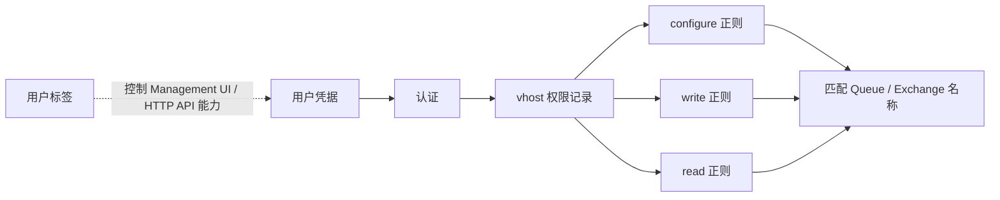

# RabbitMQ 用户与权限控制

本文介绍 RabbitMQ 的用户认证、vhost 授权、资源权限和 Management 用户标签，并给出常见场景的最小权限命令。

需要先明确：用户侧使用的是 Access Control（访问控制），严格意义上不属于 RabbitMQ Policy。RabbitMQ Policy 用于配置 Queue、Stream、Exchange 的行为，参见 [RabbitMQ 消息与资源 Policy](./rabbitmq-message-policies.md)。

## 权限模型

RabbitMQ 把认证和授权分开处理：

- 认证：确认客户端使用的是哪个用户。
- 授权：确认这个用户可以进入哪个 vhost，以及可以操作其中哪些资源。



一条资源权限记录具有两层粒度：

1. 权限记录属于一个指定的 vhost。
2. `configure`、`write`、`read` 分别使用正则表达式匹配该 vhost 中的 Queue 和 Exchange 名称。

因此，权限既不是只能控制到整个 vhost，也不是一条独立记录只能绑定一个 Queue。通过不同正则，可以授权整个 vhost、一组资源或一个具体资源。

```text
.*                                      匹配所有资源
^orders\.                               匹配所有以 orders. 开头的资源
^orders\.direct$                        只匹配 orders.direct
^(orders\.direct|billing\.order\.q)$   只匹配列出的两个资源
^$                                      不匹配普通命名资源，相当于禁止此类操作
```

资源名称区分大小写。正则中的 `.` 表示任意字符，如果需要匹配资源名称中的点号，应写成 `\.`。

## 配置、写入与读取权限

三个权限参数的顺序固定为：

```text
configure  write  read
```

| 权限 | 主要含义 |
|---|---|
| `configure` | 声明、删除 Queue 或 Exchange，以及执行需要修改资源配置的操作 |
| `write` | 向 Exchange 发布消息；在 Binding 中操作目标资源 |
| `read` | 从 Queue 消费、拉取或清空消息；在 Binding 中操作源资源 |

### 常见 AMQP 操作权限表

| 操作 | configure | write | read |
|---|---|---|---|
| 声明、删除 Exchange | Exchange | — | — |
| 声明、删除 Queue | Queue | — | — |
| 向 Exchange 发布消息 | — | Exchange | — |
| 消费或 Get Queue 中的消息 | — | — | Queue |
| Purge Queue | — | — | Queue |
| Queue 绑定或解绑 Exchange | — | 目标 Queue | 源 Exchange |
| Exchange 绑定或解绑另一个 Exchange | — | 目标 Exchange | 源 Exchange |

这里的“读写”不是文件系统意义上的读写：

- `read Exchange` 主要用于把该 Exchange 作为 Binding 的源。
- `write Queue` 主要用于把该 Queue 作为 Binding 的目标。
- 正常发布消息需要的是 `write Exchange`。
- 正常消费消息需要的是 `read Queue`。

## 队列绑定交换机所需的最小权限

假设资源已经存在：

```text
Exchange：orders.direct
Queue：billing.order.queue
```

只建立下面的 Binding：

```text
orders.direct（源）
        ↓ routing_key=order.created
billing.order.queue（目标）
```

最小权限是：

```text
write billing.order.queue
read  orders.direct
```

对应命令：

```bash
rabbitmqctl set_permissions -p / binding_user \
  '^$' \
  '^billing\.order\.queue$' \
  '^orders\.direct$'
```

因为两个资源已经存在，所以单纯创建 Binding 不需要 `configure`。

## 用户管理命令

### 创建用户

交互式创建用户，RabbitMQ 会提示输入密码：

```bash
rabbitmqctl add_user app_user
```

修改密码：

```bash
rabbitmqctl change_password app_user
```

删除用户：

```bash
rabbitmqctl delete_user app_user
```

查看用户：

```bash
rabbitmqctl list_users
```

生产环境应使用随机生成的强密码，并通过 Secret 管理系统下发，不要把真实密码提交到代码仓库。

## 权限配置示例

以下示例使用 `/` vhost。使用其他 vhost 时，将 `-p /` 替换为目标名称，例如 `-p commerce-prod`。

### 整个虚拟主机的全部资源权限

```bash
rabbitmqctl set_permissions -p / app_user '.*' '.*' '.*'
```

该用户可以创建、删除、发布、绑定和消费 `/` 中所有匹配的 Queue 和 Exchange，但这不代表它可以创建 vhost、用户或管理整个集群。

### 对所有资源只有读写权，不允许创建和删除

```bash
rabbitmqctl set_permissions -p / app_user '^$' '.*' '.*'
```

### 只给一个交换机和一个队列读写权限

假设：

```text
Exchange：orders.direct
Queue：billing.order.queue
```

```bash
rabbitmqctl set_permissions -p / app_user \
  '^$' \
  '^(orders\.direct|billing\.order\.queue)$' \
  '^(orders\.direct|billing\.order\.queue)$'
```

该用户可以：

- 向 `orders.direct` 发布消息。
- 从 `billing.order.queue` 消费消息。
- 将 `billing.order.queue` 绑定到 `orders.direct`。

该用户不能创建或删除这两个资源，因为 `configure` 为 `^$`。

### 仅发布到一个交换机

```bash
rabbitmqctl set_permissions -p / order_producer \
  '^$' \
  '^orders\.direct$' \
  '^$'
```

### 仅消费一个已经存在的队列

```bash
rabbitmqctl set_permissions -p / billing_worker \
  '^$' \
  '^$' \
  '^billing\.order\.queue$'
```

### 消费者创建自己的队列、绑定关系并消费

假设 `orders.direct` 已经由部署系统创建，消费者只负责声明自己的 Queue、创建 Binding 并消费：

```bash
rabbitmqctl set_permissions -p / billing_worker \
  '^billing\.order\.queue$' \
  '^billing\.order\.queue$' \
  '^(orders\.direct|billing\.order\.queue)$'
```

对应关系：

- `configure Queue`：声明自己的 Queue。
- `write Queue`：把 Queue 作为 Binding 的目标。
- `read Exchange`：把 Exchange 作为 Binding 的源。
- `read Queue`：消费消息。

如果消费者还会使用非 passive 的方式声明 `orders.direct`，`configure` 也必须包含该 Exchange：

```bash
rabbitmqctl set_permissions -p / billing_worker \
  '^(orders\.direct|billing\.order\.queue)$' \
  '^billing\.order\.queue$' \
  '^(orders\.direct|billing\.order\.queue)$'
```

### 按业务前缀授权

允许应用管理和使用所有以 `billing.` 开头的资源：

```bash
rabbitmqctl set_permissions -p / billing_service \
  '^billing\.' \
  '^billing\.' \
  '^billing\.'
```

如果该应用还需要从 `orders.direct` 建立 Binding，应在 `read` 中加入该 Exchange：

```bash
rabbitmqctl set_permissions -p / billing_service \
  '^billing\.' \
  '^billing\.' \
  '^(billing\.|orders\.direct$)'
```

## 死信交换机和备用交换机的声明权限

当应用在声明 Queue 时同时指定 Dead Letter Exchange，除了 Queue 的 `configure` 权限，还需要：

- 对源 Queue 的 `read` 权限。
- 对 Dead Letter Exchange 的 `write` 权限。

当应用声明 Exchange 时同时指定 Alternate Exchange，也需要对相关源、目标 Exchange 拥有相应权限。

如果 DLX、Alternate Exchange 和 Binding 由部署系统提前创建，普通生产者和消费者就不需要承担这些拓扑管理权限，可以进一步收紧应用账号。

## 查看和清除权限

查看用户在所有 vhost 中的权限：

```bash
rabbitmqctl list_user_permissions app_user
```

查看 `/` vhost 中所有用户的权限：

```bash
rabbitmqctl list_permissions -p /
```

清除用户在 `/` vhost 中的权限：

```bash
rabbitmqctl clear_permissions -p / app_user
```

权限调整后，已有 Connection 或 Channel 可能继续使用缓存的授权结果。应让相关应用重新连接后再验证。

## 用户标签

用户标签主要控制 Management UI 和 HTTP API 中的管理能力，不代替 `configure`、`write`、`read` 资源权限。

| 标签 | 主要能力 |
|---|---|
| `management` | 登录管理后台，查看用户有权限访问的 vhost 及资源 |
| `policymaker` | 在可访问的 vhost 中管理 Policy 和运行参数 |
| `monitoring` | 查看节点和全局监控信息，以及其他用户的 Connection 和 Channel |
| `administrator` | 管理用户、vhost 和权限等管理内容 |

设置标签：

```bash
rabbitmqctl set_user_tags ops_user administrator
```

清除标签：

```bash
rabbitmqctl set_user_tags app_user
```

普通 Python 或 Go 业务程序通常不需要任何用户标签。即使用户具有 `administrator` 标签，资源操作仍然要接受对应 vhost 中 `configure`、`write`、`read` 的检查。

拥有 `configure` 权限也不等于可以通过 Management UI 管理 Policy。通过 UI 或 HTTP API 管理 Policy 通常还需要 `policymaker` 或 `administrator` 标签。

## 重要边界

### 权限正则匹配名称，不匹配资源类型

资源权限正则只匹配名称。如果一个 Queue 和一个 Exchange 使用相同名称，匹配这个名称的正则可能同时对两者生效。

### 配置权限不能拆分创建和删除

RabbitMQ 不能通过这三个正则表达式实现“允许声明 Queue，但禁止删除同一个 Queue”。声明和删除都属于 `configure`。

如果需要严格控制拓扑删除，可由部署系统统一创建资源，让业务账号完全不具备 `configure` 权限。

### 直连交换机不能按路由键做普通权限隔离

用户拥有某个 direct exchange 的 `write` 权限后，可以向它使用不同 routing key 发布消息。普通资源权限不能继续把它限制为某个 routing key。

RabbitMQ 另有 Topic Authorisation，但它面向 topic exchange 和相关协议场景，不能代替 direct exchange 的资源隔离。无关业务需要隔离时，应拆分 Exchange、用户或 vhost。

### 默认交换机的权限名称

AMQP 0-9-1 客户端发布到默认 Exchange 时使用空字符串名称。RabbitMQ 在权限检查中将它映射为：

```text
amq.default
```

如果应用通过默认 Exchange 使用 Queue 名称发布消息，`write` 正则需要允许 `amq.default`。

## 生产建议

- 每个可独立部署的应用使用独立用户，不按 Python 组或 Go 组共用大账号。
- 业务程序不使用 `administrator` 账号。
- 生产者通常只需要目标 Exchange 的 `write` 权限。
- 预先创建拓扑时，消费者通常只需要目标 Queue 的 `read` 权限。
- 由消费者声明 Queue 和 Binding 时，再增加其所需的最小 `configure`、`write`、`read`。
- 使用首尾锚点编写权限正则，避免 `order` 意外匹配 `order-backup`。
- 用户、vhost 和权限配置应进入 definitions、基础设施代码或部署流水线。
- 定期轮换应用凭据，并从 RabbitMQ Connections 中核对连接使用的用户。

## 官方资料

- [Authentication, Authorisation, Access Control](https://www.rabbitmq.com/docs/access-control)
- [Virtual Hosts](https://www.rabbitmq.com/docs/vhosts)
- [Management Plugin Access and Permissions](https://www.rabbitmq.com/docs/management#permissions)
- [rabbitmqctl Manual](https://www.rabbitmq.com/docs/man/rabbitmqctl.8)
- [Production Deployment Guidelines](https://www.rabbitmq.com/docs/production-checklist)
